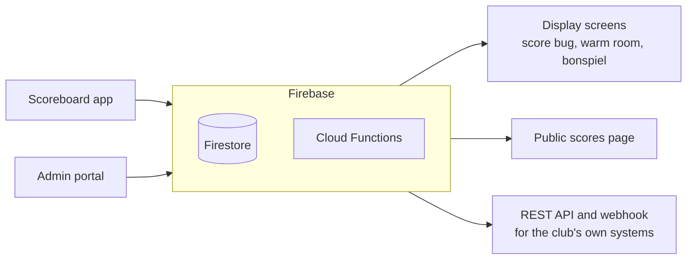

# Curling Scoreboard

A platform for curling clubs to score games at the sheet, show them live on
screens around the club and on members' phones, and run leagues and
bonspiels. It's a monorepo of products sharing one Firebase backend:

| Folder                               | Stack                      | What it is                                                                                         |
| ------------------------------------ | -------------------------- | -------------------------------------------------------------------------------------------------- |
| [`app/`](app/)                       | Flutter                    | The scoreboard on each sheet (web, mobile, desktop)                                                |
| [`admin/`](admin/)                   | React + Vite               | The admin portal for super admins, club admins and bonspiel coordinators                           |
| [`functions/`](functions/)           | Node.js + Express          | Callable functions, Firestore triggers, the REST API, the display pages and the public scores page |
| [`scripts/`](scripts/)               | Node.js                    | Seeding dev, the first super admin, one-off migrations and backfills                               |
| [`emulator-tests/`](emulator-tests/) | Node.js, Firebase emulators | Tests for `firestore.rules` and the functions                                                     |
| [`docs-check/`](docs-check/)         | Node.js, Mermaid, Playwright | Checks that the Markdown's diagrams render and its links resolve                                |

Shared Firebase config (`firebase.json`, `firestore.rules`, `firestore.indexes.json`) lives at the repo root.



## Documentation

| Read                                         | For                                                                                         |
| -------------------------------------------- | ------------------------------------------------------------------------------------------- |
| [docs/FEATURES.md](docs/FEATURES.md)         | What the system does, for everyone who uses it, in plain terms                              |
| [docs/GLOSSARY.md](docs/GLOSSARY.md)         | Curling terms for developers who don't curl, and the system's own terms                     |
| [docs/ARCHITECTURE.md](docs/ARCHITECTURE.md) | How it fits together: the system diagram, the life of a game, every Cloud Function, and a page for each area in [`docs/architecture/`](docs/architecture/) |
| [CONTRIBUTING.md](CONTRIBUTING.md)           | PR conventions, the checks to run, spelling, scoreboard text, release-managed files, keeping these docs current |
| Each folder's README                         | Running, checking and finding your way around that product                                  |
| [docs/upgrade-smoke-test.md](docs/upgrade-smoke-test.md) | Checking dev after a Node, `firebase-tools` or Firebase SDK upgrade, before it goes to prod |
| [docs/guides/](docs/guides/)                 | Step by step guides for club admins: scoreboards, screens, leagues, bonspiels, chat, members |
| [API documentation](https://curlingscoreboard.app/api-docs/) | The REST API and webhook, for club integrations                             |
| [docs/CHANGELOG.md](docs/CHANGELOG.md)       | What changed in each release                                                                |
| [CLAUDE.md](CLAUDE.md)                       | Guidance for Claude Code sessions working in the repo                                       |

---

## Prerequisites

- [Flutter](https://docs.flutter.dev/get-started/install) 3.47.6. The version is set by `environment.flutter` in `app/pubspec.yaml`, which CI reads too. With [FVM](https://fvm.app), run `fvm install` in `app/` to get it (`app/.fvmrc`).
- [Node.js](https://nodejs.org/) 24 (see `.nvmrc`), for everything: the functions run on it in production too
- [Java](https://adoptium.net/) 21 or later, only for running the emulator tests
- [Firebase CLI](https://firebase.google.com/docs/cli) — `npm install -g firebase-tools`
- [Google Cloud SDK](https://cloud.google.com/sdk/docs/install) — for local credentials via `gcloud`

The dev container in `.devcontainer/` comes with Flutter, Node and Java installed.

To move to a new Flutter version, update `app/pubspec.yaml`, `app/.fvmrc` and `FLUTTER_VERSION` in `.devcontainer/Dockerfile`.

---

## First-time setup

### 1. Authenticate

```bash
firebase login
gcloud auth application-default login
```

### 2. Select the dev project

```bash
firebase use default   # targets curling-scoreboard-dev
```

### 3. Install dependencies

From the repo root:

```bash
(cd app && flutter pub get)
(cd admin && npm install)
(cd functions && npm install)
(cd scripts && npm install)
(cd emulator-tests && npm install)
```

---

## Running locally

### Scoreboard app

Open the repo in VS Code and use the **Launch Web** run configuration (`.vscode/launch.json`). This starts the app in Chrome pointing at the live dev Firebase project (`curling-scoreboard-dev`).

To run from the terminal:

```bash
cd app
flutter run -d chrome --dart-define=FIREBASE_ENV=dev -t lib/main.dart
```

### Admin portal

```bash
cd admin
npm run dev
```

Starts the Vite dev server. The portal uses the dev Firebase project by default.

### Functions

The app and admin portal always talk to the live dev project's deployed functions. To deploy your changes to dev:

```bash
firebase deploy --only functions --project curling-scoreboard-dev
```

Before that, the functions and the Firestore rules can be tested locally against the Firebase emulators (needs Java 21 or later):

```bash
cd emulator-tests
npm test
```

See [`emulator-tests/README.md`](emulator-tests/README.md) for what the tests cover.

---

## Seeding dev data

A seed script fills the dev Firestore with clubs, sheets, leagues and game
history:

```bash
cd scripts
npm install
node seed-dev.js
```

See [`scripts/README.md`](scripts/README.md) for what it creates, how to point
it at another project, and the one-off migrations and backfills that went with
past deploys.

---

## Display links

`startDisplaySession` signs display screens in with a custom token. Deployed, the Admin SDK signs those through the IAM Credentials API as the functions' runtime service account, which by default is the Compute Engine default service account. It needs the Service Account Token Creator role on itself, or the function fails with "Permission 'iam.serviceAccounts.signBlob' denied". Once per project:

```bash
gcloud services enable iamcredentials.googleapis.com --project=PROJECT_ID
gcloud iam service-accounts add-iam-policy-binding \
  PROJECT_NUMBER-compute@developer.gserviceaccount.com \
  --member=serviceAccount:PROJECT_NUMBER-compute@developer.gserviceaccount.com \
  --role=roles/iam.serviceAccountTokenCreator --project=PROJECT_ID
```

The emulator signs nothing, so the tests do not need this.

---

## Admin accounts

### Creating the first super admin

Super admins manage every club in the admin portal. The `setSuperAdminClaim` function can only be called by an existing super admin, so the first one in a project is created with a script. Create the user first (Firebase console → Authentication → Add user), then:

```bash
cd scripts
node set-super-admin.js someone@example.com                                              # dev
FIREBASE_PROJECT_ID=curling-scoreboard-prod node set-super-admin.js someone@example.com  # prod
```

The user has to sign out and back in to the admin portal before the new role takes effect. Club admins are created from the admin portal by a super admin.

---

## Deployments

### PR checks

Opening a PR triggers the [validate_pr](https://github.com/CloudgateStudios/curling_scoreboard/actions/workflows/validate_pr.yaml) workflow. It always checks that the PR title follows the conventional commit format and spell checks the repo. The product checks only run when that product's files changed:

| When these change                                                     | Checks                                                                                  |
| --------------------------------------------------------------------- | --------------------------------------------------------------------------------------- |
| `app/`                                                                | Formatting, analysis, web build, tests, Android release build, unused localized strings |
| `admin/`                                                              | Type checking, lint, tests, build                                                       |
| `functions/`                                                          | Build, lint                                                                             |
| `functions/`, `firestore.rules`, `firebase.json` or `emulator-tests/` | Firestore rules tests, Cloud Functions tests and the smoke test script against the emulators |
| `scripts/`                                                            | Syntax check; the emulator tests too when the smoke test or its dependencies change     |
| Any Markdown file, or `docs-check/`                                   | Mermaid diagrams render, relative links and anchors resolve                             |

Changing a workflow file runs the checks for the product it builds or deploys.

Nothing is deployed from a PR; deploys start once it merges to `main`.

### Dev

Every push to `main` automatically deploys all three products to the live dev environment:

| Workflow                                                                                                                   | Deploys                           |
| -------------------------------------------------------------------------------------------------------------------------- | --------------------------------- |
| [deploy_web_dev](https://github.com/CloudgateStudios/curling_scoreboard/actions/workflows/deploy_web_dev.yaml)             | Flutter web app                   |
| [deploy_admin_dev](https://github.com/CloudgateStudios/curling_scoreboard/actions/workflows/deploy_admin_dev.yaml)         | Admin portal                      |
| [deploy_functions_dev](https://github.com/CloudgateStudios/curling_scoreboard/actions/workflows/deploy_functions_dev.yaml) | Cloud Functions + Firestore rules |

After an upgrade to Node, `firebase-tools` or the Firebase SDKs, work through the [upgrade smoke test](docs/upgrade-smoke-test.md) on dev before releasing to prod.

### Prod

First, generate a version tag using the [version_increment](https://github.com/CloudgateStudios/curling_scoreboard/actions/workflows/version_increment.yaml) workflow, choosing whether to bump the patch, minor or major version. It reads the commits since the last release, writes the [changelog](https://github.com/CloudgateStudios/curling_scoreboard/blob/main/docs/CHANGELOG.md) and [release notes](https://github.com/CloudgateStudios/curling_scoreboard/blob/main/docs/RELEASE_NOTES.md), and pushes the release commit and tag to `main` as the studio's Release Bot GitHub App.

Then trigger each prod workflow manually, entering the version tag (e.g. `0.0.37`):

| Workflow                                                                                                                     | Deploys                           |
| ---------------------------------------------------------------------------------------------------------------------------- | --------------------------------- |
| [deploy_web_prod](https://github.com/CloudgateStudios/curling_scoreboard/actions/workflows/deploy_web_prod.yaml)             | Flutter web app                   |
| [deploy_admin_prod](https://github.com/CloudgateStudios/curling_scoreboard/actions/workflows/deploy_admin_prod.yaml)         | Admin portal                      |
| [deploy_functions_prod](https://github.com/CloudgateStudios/curling_scoreboard/actions/workflows/deploy_functions_prod.yaml) | Cloud Functions + Firestore rules |

Each workflow checks out the exact tag and deploys it to the live prod environment (`curling-scoreboard-prod`).

### Adding a new callable Cloud Function

Callable functions (`onCall`) must be callable by anyone, because each one checks the caller itself. The Google Cloud organization that owns both projects blocks public access by default, through the "Domain restricted sharing" organization policy (`iam.allowedPolicyMemberDomains`). Both Firebase projects override it to allow public access. Without that override, deploying a new function fails with "Unable to set the invoker for the IAM policy", and later deploys skip the function as unchanged, leaving it unreachable.

If a new project is ever added, override the policy there before deploying functions:

```bash
cat > /tmp/allow-public.yaml <<'EOF'
name: projects/PROJECT_ID/policies/iam.allowedPolicyMemberDomains
spec:
  rules:
  - allowAll: true
EOF
gcloud org-policies set-policy /tmp/allow-public.yaml
```

To fix a function that was already deployed without public access:

```bash
gcloud functions add-invoker-policy-binding FUNCTION_NAME \
  --region=us-central1 --member=allUsers --project=PROJECT_ID
```
