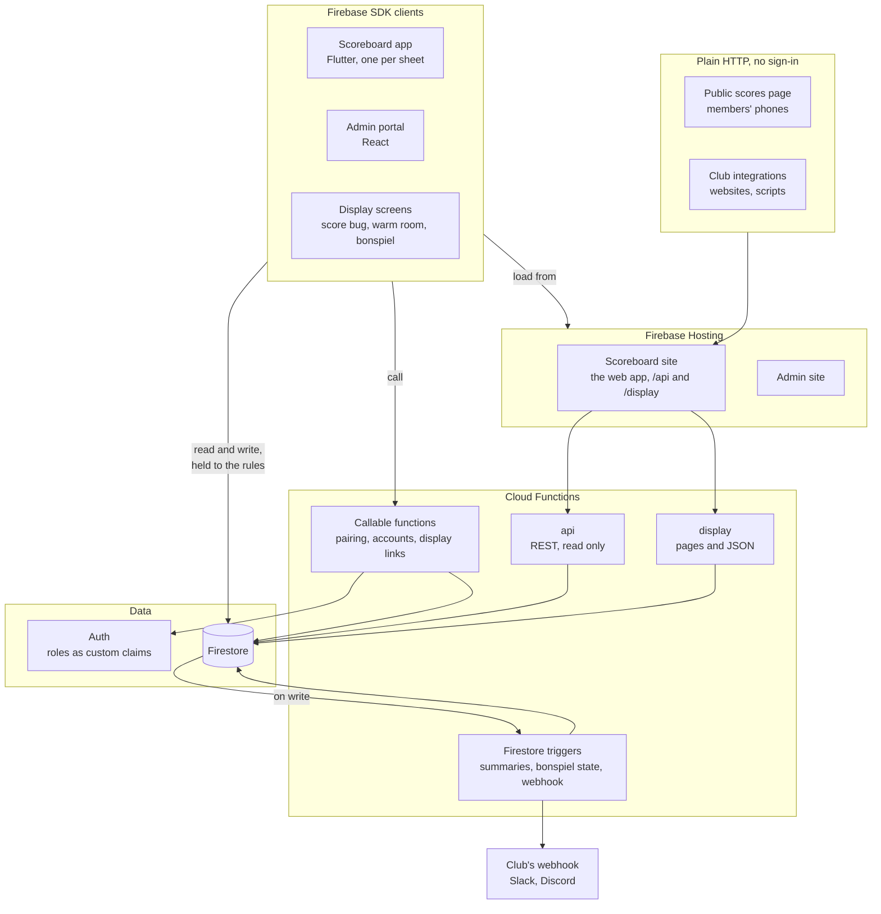
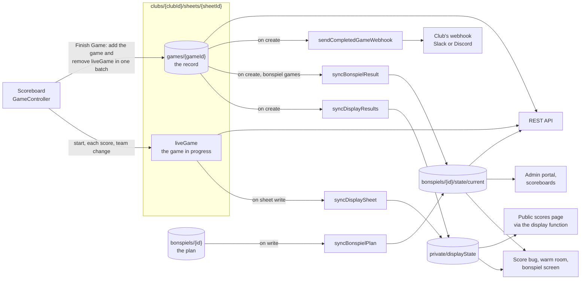

# Architecture

How the scoreboard app, the admin portal, the display pages and the Cloud
Functions fit together on Firebase. This page is the map; each area has its
own page under [`docs/architecture/`](architecture/) with the detail. For
what the system does in plain terms, see [FEATURES](FEATURES.md); for setup
and day to day commands, the [README](../README.md); for how to make and ship
a change, [CONTRIBUTING](../CONTRIBUTING.md).

## The system at a glance

| Client             | Loads from                    | Reads and writes Firestore                                 | Calls                                              |
| ------------------ | ----------------------------- | ---------------------------------------------------------- | -------------------------------------------------- |
| Scoreboard app     | Scoreboard site (web builds)  | Writes `liveGame`, `games` and `device`; reads club config | `pairSheet`, `unpairSheet`                         |
| Admin portal       | Admin site                    | Club data, leagues, bonspiels and settings                 | Account, display link and test webhook functions   |
| Display screens    | `/display/**`                 | Listens to the display summary and its link                | `startDisplaySession`                              |
| Public scores page | `/display/{clubId}/scores`    | Nothing: polls JSON the CDN caches                         | —                                                  |
| Club integrations  | `/api/v1/**`                  | Nothing: the `api` function reads for them                 | —                                                  |

| Piece                 | Runs on                                                       | Talks to                                                                                                                                                                                    |
| --------------------- | ------------------------------------------------------------- | ------------------------------------------------------------------------------------------------------------------------------------------------------------------------------------------- |
| [`app/`](../app/)             | Flutter web (Firebase Hosting, `app` target), Android, others | Firestore directly; the `pairSheet` and `unpairSheet` functions                                                                                                                             |
| [`admin/`](../admin/)         | React SPA (Firebase Hosting, `admin` target)                  | Firestore directly; the `provisionClub`, `addClubAdmin`, `updateClubAdmin`, `removeClubAdmin`, `deleteSheet`, `createDisplayLink`, `resetDisplayLink`, `revokeDisplayLink` and `sendTestWebhook` functions |
| [`functions/`](../functions/) | Cloud Functions (2nd gen, `us-central1`)                      | Firestore and Auth with admin access; also serves the REST API, the display pages and the public scores page                                                                               |
| [`scripts/`](../scripts/)     | A developer's machine, with Application Default Credentials   | Firestore and Auth with admin access: seeding dev, one-off migrations and backfills, the first super admin                                                                                  |
| [`emulator-tests/`](../emulator-tests/) | CI and developers' machines, against the Firebase emulators | The rules and the functions, the way the clients use them                                                                                                                             |

There are two Firebase projects, `curling-scoreboard-dev` and
`curling-scoreboard-prod`, with the same layout. Access control lives in
`firestore.rules`; anything a client cannot be trusted to do runs in a Cloud
Function instead.

## What holds everywhere

A few rules shape every part of the system, so they are worth knowing before
the detail:

- **The scoreboard never depends on Firebase.** It works fully offline and
  unpaired. Pairing with a club only adds syncing, and every write is fire
  and forget, so a failed write never interrupts scoring.
- **A game result is recorded once.** The scoreboard writes one `games`
  document at Finish Game. Everything else that shows a result is made from
  it by a function, and can be made again.
- **Functions rebuild from documents, not events.** Triggers can arrive late,
  out of order or twice, so each one reads the documents as they are now and
  writes the whole result in a transaction. A repeated delivery writes the
  same thing again.
- **Readers that stay open read one document.** Display screens are left on
  for weeks, so each club has one summary document they listen to, and the
  public scores page reads cached JSON, not Firestore.
- **Secrets live under `private/`.** The API key, the scoreboard PIN and the
  webhook URL are in `clubs/{clubId}/private/*`, which scoreboards and
  displays cannot read.
- **Roles are custom claims, set only by functions or scripts.** The rules
  check them, and a scoreboard's access also depends on its sheet still
  naming it.

## The life of a game

Everything that shows a score, anywhere, starts from two writes the
scoreboard makes.

[Where game results live](architecture/data-model.md#where-game-results-live)
lists every copy, who writes it and who reads it.

## Cloud Functions

Every function the `functions/` package exports, from `functions/src/index.ts`.

| Function                   | Kind                         | Fires on, or who may call it                                      | Source                       |
| -------------------------- | ---------------------------- | ----------------------------------------------------------------- | ---------------------------- |
| `api`                      | HTTPS (Express)              | `/api/**` through Hosting; a club's `X-API-Key`                   | `index.ts`, `routes/`        |
| `display`                  | HTTPS (Express)              | `/display/**` through Hosting; anyone                             | `display/pages.ts`           |
| `provisionClub`            | Callable                     | Super admins: a new club, its first admin and scoreboard PIN      | `admin.ts`                   |
| `setSuperAdminClaim`       | Callable                     | Super admins                                                      | `admin.ts`                   |
| `addClubAdmin`             | Callable                     | Super admins                                                      | `admin.ts`                   |
| `updateClubAdmin`          | Callable                     | Super admins                                                      | `admin.ts`                   |
| `removeClubAdmin`          | Callable                     | Super admins                                                      | `admin.ts`                   |
| `deleteSheet`              | Callable                     | Super admins                                                      | `admin.ts`                   |
| `pairSheet`                | Callable                     | A signed in scoreboard with no admin role                         | `pairing.ts`                 |
| `unpairSheet`              | Callable                     | The paired scoreboard, with the club's PIN                        | `pairing.ts`                 |
| `createDisplayLink`        | Callable                     | The club's admins and super admins                                | `display/links.ts`           |
| `resetDisplayLink`         | Callable                     | The club's admins and super admins                                | `display/links.ts`           |
| `revokeDisplayLink`        | Callable                     | The club's admins and super admins                                | `display/links.ts`           |
| `startDisplaySession`      | Callable                     | Anyone holding a display link's token                             | `display/links.ts`           |
| `sendTestWebhook`          | Callable                     | The club's admins and super admins                                | `webhook.ts`                 |
| `syncDisplaySheet`         | Firestore, document written  | `clubs/{clubId}/sheets/{sheetId}`                                 | `display/triggers.ts`        |
| `syncDisplayResults`       | Firestore, document created  | `clubs/{clubId}/sheets/{sheetId}/games/{gameId}`                  | `display/triggers.ts`        |
| `syncBonspielPlan`         | Firestore, document written  | `clubs/{clubId}/bonspiels/{bonspielId}`                           | `bonspiels/triggers.ts`      |
| `syncBonspielResult`       | Firestore, document created  | `clubs/{clubId}/sheets/{sheetId}/games/{gameId}`                  | `bonspiels/triggers.ts`      |
| `sendCompletedGameWebhook` | Firestore, document created  | `clubs/{clubId}/sheets/{sheetId}/games/{gameId}`                  | `webhook.ts`                 |

Callable functions check their callers themselves, so each must be public;
see "Adding a new callable Cloud Function" in the README.

## Where to read more

| Page                                                        | What it covers                                                                                                         |
| ----------------------------------------------------------- | ---------------------------------------------------------------------------------------------------------------------- |
| [Data model](architecture/data-model.md)                    | Every Firestore document and field, who writes each, and where game results live                                      |
| [Auth and roles](architecture/auth-and-roles.md)            | The six roles, how each gets its claims, what the rules let each read and write, and managing accounts                |
| [Scoreboard app](architecture/scoreboard.md)                | The app's structure, pairing, disconnecting, syncing scores, rock colors and status reports                           |
| [Leagues and teams](architecture/leagues.md)                | League documents, the CSV import, and picking league teams on the scoreboard                                          |
| [Bonspiels](architecture/bonspiels.md)                      | Bonspiel plans, how the state and brackets are worked out, pools, templates, and bonspiel games on the scoreboard     |
| [Displays](architecture/displays.md)                        | The display summary, display links, the score bug, warm room and bonspiel screens, and the public scores page         |
| [Admin portal](architecture/admin-portal.md)                | Routes by role, and what each tab and settings group does                                                             |
| [REST API and webhook](architecture/api-and-webhook.md)     | The public read only API and the completed game webhook                                                               |
| [Deploys and updates](architecture/deploys-and-updates.md)  | Environments, CI and the deploy pipeline, how scoreboards and display pages update themselves, and hosting headers    |
