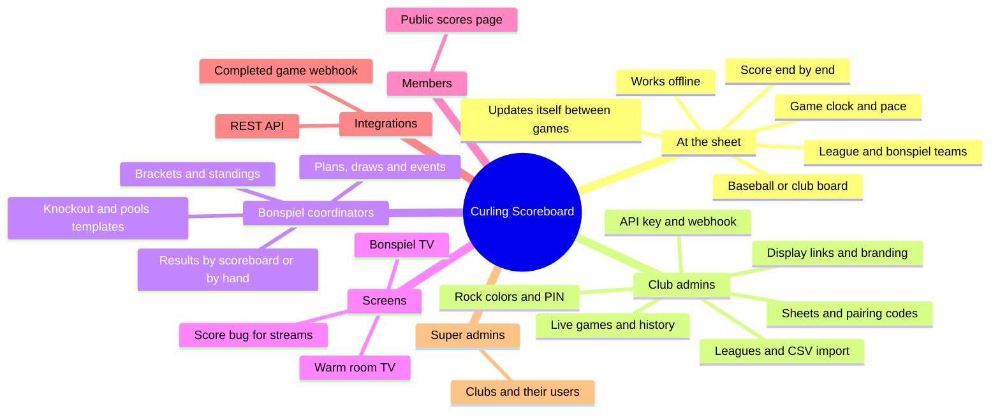

# Features

What Curling Scoreboard does, in plain terms, for everyone who uses it: the
players at the sheet, the club's staff, bonspiel coordinators, members
following along, and the club's own systems. Each section links to how it
works, in the [architecture docs](ARCHITECTURE.md).

## Feature map

## Who uses what

| Who                        | Uses                                                   | Signs in with                         |
| -------------------------- | ------------------------------------------------------ | ------------------------------------- |
| Players at the sheet       | The scoreboard app on a tablet or screen at each sheet | Nothing; a club admin pairs it once   |
| Club admins                | The admin portal                                       | Email and password                    |
| Bonspiel coordinators      | The admin portal's Bonspiels tab                       | Email and password, as bonspiel admin |
| Streamers, bar and lobby   | Display screens: score bug, warm room, bonspiel screen | A display link from a club admin      |
| Members                    | The public scores page on their phones                 | Nothing, once the club turns it on    |
| The club's website or chat | The REST API, the completed game webhook               | The club's API key; a webhook URL     |
| Super admins               | The admin portal, across every club                    | Email and password                    |

## At the sheet: the scoreboard

The scoreboard is an app on a screen at each sheet, usually a tablet or a
browser on a TV. It is built to be tapped at by anyone between ends.

- **Set up a game** on one screen: the number of ends, players per team, and
  who has hammer in the first end. At a club with leagues, a bar on the
  screen suggests the league playing now and a tap brings up its teams as
  big buttons. During a bonspiel it offers this sheet's game in the current
  draw instead, with the teams already filled in as the bracket works them
  out.
- **Score end by end.** Add Score enters who scored and how many, or a blank
  end. Tap any earlier end to fix it, or delete one entered twice. The
  hammer follows the scores, and a tied game goes to an extra end.
- **Keep to time.** A game clock shows how long the game has run and how far
  ahead or behind the usual pace it is: 15 minutes an end for fours, 12 for
  doubles.
- **Two boards.** Settings switches between a baseball style board, a column
  an end, and the classic curling club board.
- **Finish** happens by itself once the last end is scored and the game is
  not tied, or with Finish Game. A game report shows each end and how long it
  took.
- **Fix the teams** at any point in a game with the Teams button, for teams
  who forgot to pick their names, or picked the wrong ones.
- **Works without the internet.** Scoring never waits on the network. A
  paired scoreboard sends its scores when it can, and remembers its club's
  colors, leagues and bonspiels for an offline start.
- **Stays up to date by itself.** The web scoreboard picks up a new version
  between games, after two minutes with nobody touching it, with a countdown
  anyone can stop by tapping.
- **Hard to disconnect by accident.** Disconnecting from the club means
  pressing and holding the connection for four seconds, then entering the
  club's admin PIN.

How it works: [Scoreboard app](architecture/scoreboard.md),
[Leagues](architecture/leagues.md#league-games-on-the-scoreboard),
[Bonspiels](architecture/bonspiels.md#on-the-scoreboard).

## Running the club: the admin portal

Club admins run their club from the admin portal in a browser.

- **Sheets and scoreboards.** Each sheet shows the game on it now, live, and
  whether its scoreboard is online, which version it runs, and whether it is
  waiting to update. A pairing code connects a new scoreboard to a sheet.
- **Game history.** Every finished game, end by end, for the last week or a
  sheet's whole history, fifty at a time, with a CSV export for keeping standings in a
  spreadsheet.
- **Leagues.** Each league's season, weekly draw times and teams, entered by
  hand or imported from a spreadsheet. Re-importing keeps teams matched to
  their past games, and the portal shows what will change before it saves.
  A week view lays out every league's draws and flags any that overlap.
- **Scoreboard settings.** The club's rock colors, if not red and yellow,
  and the admin PIN that scoreboards ask for before they disconnect.
- **Displays.** Links for the club's screens, the warm room screen's title
  and logo, and the switch for the public scores page.
- **Integrations.** The club's API key, and where to post finished games.

How it works: [Admin portal](architecture/admin-portal.md).

## Bonspiels

Bonspiel coordinators, who can be given access to bonspiels and nothing
else, plan and run each bonspiel in the portal.

- **Any format.** A bonspiel is its draws, its sheets and its games. Each
  side of a game is a team, the winner or loser of an earlier game, or a
  place in a pool's standings, so knockouts, A/B/C events, round robin pools
  with playoffs, and anything in between are all written the same way.
- **Templates** fill in a bonspiel from a list of teams: a knockout of up to
  64 teams in one to four events, or up to eight round robin pools feeding a
  playoff. What they make can be edited like anything else.
- **A draw board** shows the draws down the side and the sheets across, and
  the portal checks the plan makes sense before it saves.
- **Results come in by themselves.** A game started from the scoreboard's
  bonspiel bar sends its result to the bracket when it finishes, and the
  winners and losers move on to their next games. A coordinator can enter or
  correct any result by hand, settle a tie, and order teams level in a pool.
- **Brackets and standings** show each event round by round, with its winner,
  and each pool's table.
- **Run it again** next year by duplicating it to new dates.

How it works: [Bonspiels](architecture/bonspiels.md).

## Screens around the club

A club admin makes a link for each screen in the portal and can change what
it shows from there at any time, even mid-stream, without touching the
screen.

- **Score bug** for live streams: a transparent overlay of one sheet's score
  for OBS, with the teams' rock colors, hammer and end. It hides itself
  between games, and has a preview mode for placing it.
- **Warm room screen** for a TV: every sheet at once, filling the screen at
  any size or way round. It can show totals, every end, or both in turn, the
  day's finished games down the side, and the club's own title and logo.
- **Bonspiel screen** for a TV during a bonspiel: the draw on now, the
  schedule, and the brackets and standings, in turn.

Screens are left on for weeks, so they recover from network trouble on their
own, update themselves to new versions, and report to the portal whether
they are open and up to date.

How it works: [Displays](architecture/displays.md).

## Members' phones: the public scores page

Once a club turns it on, members can follow every sheet from their phones at
one address, with no app and no sign-in: the score, end and hammer, each game
end by end, and the day's results grouped by draw. It stays cheap to run
however many people watch, and scores reach phones within about a minute.

How it works: [Public scores page](architecture/displays.md#public-scores-page).

## The club's own systems

- **REST API.** A read only API for the club's website or scripts: its sheets
  and the games on them now, finished games, leagues and teams, and bonspiels
  with their brackets. Every request carries the club's API key. Full
  reference at [`/api-docs/`](https://curlingscoreboard.app/api-docs/).
- **Completed game webhook.** Each finished game posted to a URL, usually a
  Slack or Discord channel, as a message the club can word itself. It can be
  every game, only league games, or only bonspiel games, and on Discord it
  posts without pinging anyone.

How it works: [REST API and webhook](architecture/api-and-webhook.md).

## Super admins

Super admins look after every club: they create clubs and their users (club
admins and bonspiel admins), add and remove sheets, and rotate API keys.

How it works: [Auth and roles](architecture/auth-and-roles.md).
