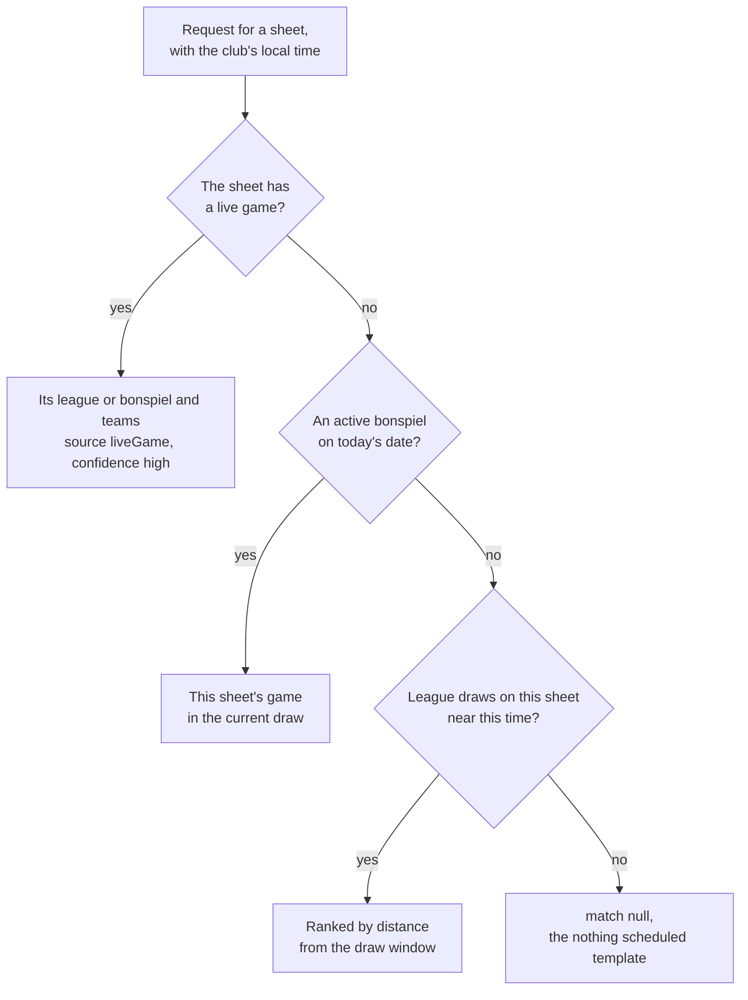

# Stream title proposal

Draft for discussion · November 3, 2026

## The problem

The club wants a YouTube stream on each sheet that any member can start and
stop, with no one typing a title. The streaming tool needs to ask "what is
on this sheet right now?" and get back a title and a description, such as
"Monday Night Men's · Sheet 2 · November 3, 2026".

The schedule is already in Firestore. Each league has weekly draws
(`{ day, start, end }`) and each bonspiel has dated draws with a game per
sheet. What is missing is a way to ask the question from outside, and a
lookup forgiving enough for a 6:30 draw that goes live at 6:15 or 6:40.

## Decisions so far

- **One stream per sheet.** The tool always sends its `sheetId`.
- **The club gets a time zone**, set in the admin portal.
- **Split leagues.** Today every league has the whole ice, but other clubs
  run two leagues at once on different sheets. Draws gain optional sheets.
- **Title and description**, both from templates the club can change in
  the portal, with sensible defaults.

## What the API has today

The REST API (`functions/src/routes/`) is read only and keyed per club with
`X-API-Key`:

- `GET /clubs/{clubId}` and `/sheets/{sheetId}`: each sheet's live game, with
  its `league` or `bonspiel` and both teams once a game has started.
- `GET /clubs/{clubId}/leagues` and `/leagues/{leagueId}`: draws, season
  dates and teams.
- `GET /clubs/{clubId}/bonspiels` and `/bonspiels/{bonspielId}`: the plan,
  with each game's teams worked out.

A tool could do the lookup itself from these, but it would have to repeat
rules the scoreboard already has, and get the time zone right on its own.

### The time zone gap

Every schedule time is a plain local time with no zone. That works today
because everything that compares them, the scoreboard, the portal and the
display pages, is on a clock at the club. The functions run in UTC, and the
club has no time zone. The only zone stored is the one saved with the
webhook message, in `private/webhook`.

## The endpoint

```
GET /api/v1/clubs/{clubId}/sheets/{sheetId}/now?at=2026-11-03T18:22
X-API-Key: ...
```

It sits under the sheet, next to the sheet's `games`, because a stream is a
sheet's. `at` is optional: a local time, `YYYY-MM-DDTHH:mm`, with no offset,
used as is. Without it the function uses the club's time zone. A club with
no time zone set must send `at`, and gets a 400 without it rather than a
guess made in UTC.

### Response

```json
{
  "at": "2026-11-03T18:22",
  "timeZone": "America/Chicago",
  "title": "Monday Night Men's · Sheet 2 · November 3, 2026",
  "description": "Monday Night Men's on Sheet 2 at Windy City Curling.\nLive scores: https://...",
  "match": {
    "kind": "league",
    "source": "schedule",
    "confidence": "high",
    "league": { "id": "abc", "name": "Monday Night Men's", "shortName": "Men's" },
    "draw": { "day": 1, "start": "18:30", "end": "20:30", "date": "2026-11-03" },
    "minutesFromStart": -8,
    "team1": null,
    "team2": null
  },
  "candidates": [
    { "kind": "league", "...": "the same fields, for each league that was close, best first" }
  ]
}
```

- `match` is the best guess, or null when nothing is near. `title` and
  `description` are always filled in, from the club's "nothing scheduled"
  template when there is no match, so the tool always has something to post.
- `candidates` lists everything that was close, best first. A kiosk with a
  Start button can show the top two or three for a member to tap when
  `confidence` is not high, instead of trusting the guess.
- `source` says where the answer came from: `liveGame` (the scoreboard is
  already playing it) or `schedule`.
- `team1` and `team2` are filled in once known: from the live game, or from
  the bonspiel's plan.

### How the match is chosen

In order, the first that gives an answer wins.



1. **A live game on the sheet.** A scoreboard that has started a game
   already knows its league or bonspiel and its teams. This is the most
   reliable answer, and it costs nothing more: the sheet is read anyway.
2. **A bonspiel on its dates.** Use the existing "draw on now" rule: from 30
   minutes before a draw until 30 minutes before the next, and this sheet's
   game in it. Bonspiel draws are dated and games have sheets, so there is
   little to guess. A sheet with no game in the current draw falls through
   to the leagues.
3. **League draws, loosely.** For each active league in its season, take
   each draw on today's weekday that uses this sheet (and yesterday's, for a
   draw that runs past midnight), and measure how far `at` is from its
   window, the start to the end:

   | Where `at` falls                         | Confidence |
   | ---------------------------------------- | ---------- |
   | 30 minutes before the start, to the end  | high       |
   | 30 to 90 minutes before the start        | medium     |
   | Anything further, up to 3 hours away     | low        |

   The 30 minute lead is the one the scoreboard's league bar already uses
   (`League.leadTime`), so the stream and the scoreboard agree on what is
   "playing now". A 6:30 draw started at 6:15 or 6:40 is high either way.
   Ties go to the draw whose start is nearest. If two leagues are both high
   on the same sheet, which a correct schedule never gives, the first is
   kept as `match` but marked `medium`, so a kiosk knows to ask.

The tool calls the endpoint when a member presses Start, creates the
broadcast with `title` and `description`, and calls it again a few minutes
in. If the answer changed, for example from the schedule's guess to a live
game with teams, it updates the broadcast. YouTube allows that while live.

## Split leagues

Each league draw gains an optional list of sheets:

```
draws: [{
  day: int
  start: string
  end: string
  sheetIds?: string[]        // the sheets it plays on; absent means every sheet
}]
```

Absent means the whole ice, so every league stored today keeps working with
no migration. It goes on the draw, not the league, because a league can play
on sheets 1 to 3 one night and 4 to 6 another, and because two leagues
splitting the ice is a fact about one time slot.

- **Portal.** Each draw on a league's page gets a sheet picker, "All sheets"
  by default. The portal warns, without blocking, when two leagues' draws
  overlap in time on the same sheet.
- **CSV import.** An optional `sheets` column, with the sheets' names
  separated by `;`, such as `Sheet 1;Sheet 2;Sheet 3`. Names match the
  club's sheets, and a name that matches none is shown in the preview as an
  error.
- **API.** `GET /leagues` returns `sheetIds` on each draw, null for every
  sheet.
- **Rules.** The league rules check the draw's outline, as they do now, with
  `sheetIds` a list of up to 32 strings.

The scoreboard's league bar would gain the most from this: with sheets on
the draws, "exactly one league playing now" can be asked of this sheet, so a
split night names the right league instead of saying "Choose league". That
touches `app/lib/models/league.dart` and the warm room's
`results-model.js`, so it is worth doing in the same change or straight
after, so the stream and the scoreboard never disagree.

## Templates in the portal

A new Streams card under Settings, Integrations, beside the webhook, with a
title and a description for each kind of match:

| Kind                  | Default title                                    | Default description                                                        |
| --------------------- | ------------------------------------------------ | -------------------------------------------------------------------------- |
| League                | `{league} · {sheet} · {date}[ · {matchup}]`      | `{league} on {sheet} at {club}, {weekday} {date}.[\nLive scores: {scoresUrl}]` |
| Bonspiel              | `{bonspiel} · {draw} · {bonspielGame}[ · {matchup}]` | `{bonspiel}, {event}, {draw} on {sheet} at {club}.[\nLive scores: {scoresUrl}]` |
| Nothing scheduled     | `{club} · {sheet} · {date}`                      | `Curling on {sheet} at {club}.`                                            |

A club that changes nothing gets these. Each field can be left blank to go
back to its default.

### Variables

The same braces as the webhook message, so a club admin learns one thing:

| Variable                         | Value                                                         |
| -------------------------------- | ------------------------------------------------------------- |
| `{club}`, `{sheet}`              | The club's and the sheet's names                              |
| `{league}`, `{leagueShort}`      | The league's name, and its short name or else its name        |
| `{bonspiel}`, `{event}`, `{draw}`, `{bonspielGame}` | From the bonspiel's plan: "Founders Cup", "A Event", "Draw 5", "A7" |
| `{team1}`, `{team2}`, `{matchup}` | The teams once known; `{matchup}` is "Smith v Jones"         |
| `{date}`, `{shortDate}`, `{weekday}` | The draw's day, so a stream started at 12:10 a.m. keeps its evening |
| `{drawTime}`                     | The draw's scheduled start, "6:30 PM"                         |
| `{scoresUrl}`                    | The public scores page, when the club has it switched on      |

### Optional parts

Teams are often not known when the stream starts, and a club may not have
public scores. A plain template would then post "Monday Night · Sheet 2 ·
November 3 · v". So a template can put a part in square brackets, and the
part is left out when any variable inside it is empty:

```
{league} · {sheet}[ · {matchup}]
```

gives "Monday Night · Sheet 2" before the game and "Monday Night · Sheet 2
· Smith v Jones" once the teams are picked. A literal bracket is written
`[[` or `]]`. The webhook message would gain the same rule for free, which
helps its `{league}` in an open game too.

### Limits

YouTube allows 100 characters in a title, no `<` or `>`, and 5,000 in a
description. The function removes `<` and `>`, and cuts a long title at a
word with "…". The portal's preview fills a template with sample values for
each kind, as the webhook's does, and warns when the sample title is over
100 characters. Templates are up to 300 characters for a title and 5,000 for
a description, checked in the rules.

### Where it is stored

| Document                         | Holds                                   | Why there                                                                   |
| -------------------------------- | --------------------------------------- | --------------------------------------------------------------------------- |
| `clubs/{clubId}/config/club`     | `timeZone`, an IANA zone                | Club admins can write `config`, scoreboards can read it, and it is not secret |
| `clubs/{clubId}/config/stream`   | `templates.{league,bonspiel,none}.{title,description}` | The same, kept apart from the time zone so each rule stays short |

The time zone is set on the club's Settings page, defaulted to the admin's
browser zone the first time, as the webhook template is. The webhook can
later default to it, keeping its own setting for clubs that want another.

The variables and the optional parts are worked out in
`functions/src/webhookMessage.ts`, grown into a shared template module, and
mirrored for the preview in `admin/src/lib/webhookMessage.ts`, which are
already a mirrored pair.

## Security

The tool holds the club's API key. The API is read only, so a key on a club
PC can at worst read the club's schedule and scores. A key limited to `/now`
is possible later if a club wants one.

## What changes

| Area                                   | Change                                                                                          |
| -------------------------------------- | ----------------------------------------------------------------------------------------------- |
| `functions/src/routes/now.ts`          | The endpoint and the matching, as pure functions so they can be tested without Firestore        |
| `functions/src/routes/sheets.ts`       | Mount it under the sheet                                                                        |
| `functions/src/webhookMessage.ts`      | Shared variables and the optional parts                                                         |
| `admin/`                               | Time zone setting; Streams card with preview; sheet picker on league draws; CSV `sheets` column |
| `firestore.rules`                      | `config/club`, `config/stream`, and `sheetIds` on league draws                                  |
| `app/lib/models/league.dart`           | Read `sheetIds`; the league bar asks about this sheet                                           |
| `functions/src/display/assets/results-model.js` | A draw's sheets when grouping the warm room's results                                  |
| `app/web/openapi.yaml`                 | Describe `/now` and `sheetIds`                                                                  |
| `emulator-tests/`                      | Rules for the new documents and fields; functions cases for each step of the match, split leagues, after midnight, no time zone, templates with optional parts |
| Docs                                   | `api-and-webhook.md`, `leagues.md`, `data-model.md`, `FEATURES.md`, and the mirrored code list in `CLAUDE.md` |

The "playing now" rule would then exist in a fourth place, the functions,
next to `app/lib/models/league.dart`, `assets/results-model.js` and the
bonspiel models. It should be added to the mirrored code list so a change to
the lead time, or to how sheets are matched, is made everywhere.

## Suggested order

1. **Club time zone**, in the portal and `config/club`. Small, and useful on
   its own.
2. **`/now` with fixed default templates.** Enough to build the stream tool
   against.
3. **Sheets on league draws**, in the portal, the import, the endpoint and
   the scoreboard's league bar.
4. **Club templates** and optional parts, in the portal and the webhook.

## Open questions

- Should the Streams card also hold the YouTube settings the tool needs,
  such as privacy (public or unlisted) and a playlist per league? That would
  make the endpoint the one place the tool is configured, but it is a step
  from "what is on" towards "how to stream it".
- Should a bonspiel's games pick their own template per event, for a club
  that names its A event final differently? The default covers it with
  `{event}`, so this can wait.
