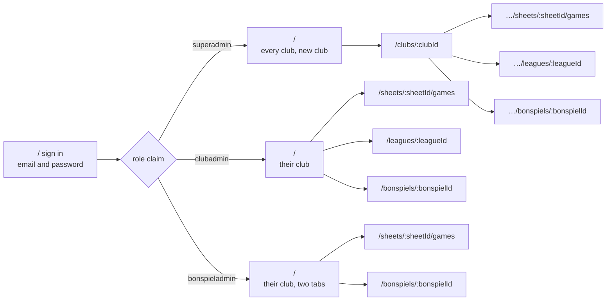
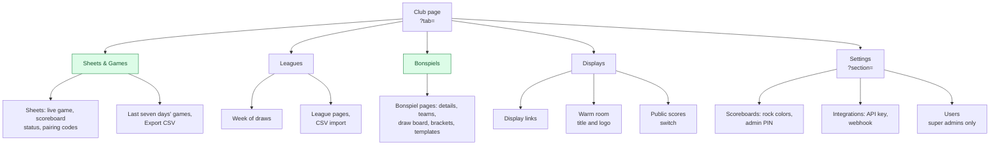

# Admin portal

The React app club staff and super admins manage everything in. Part of the
[architecture docs](../ARCHITECTURE.md). The code is in
[`admin/`](../../admin/), whose README maps its folders.

## Routes

Routes depend on the signed in role:

- Super admin: `/` lists every club and creates new ones; `/clubs/:clubId`
  shows a club; `/clubs/:clubId/sheets/:sheetId/games` its game history;
  `/clubs/:clubId/leagues/:leagueId` a league;
  `/clubs/:clubId/bonspiels/:bonspielId` a bonspiel.
- Club admin: `/` is their club; `/sheets/:sheetId/games` a sheet's history;
  `/leagues/:leagueId` a league; `/bonspiels/:bonspielId` a bonspiel.
- Bonspiel admin: the club admin's routes without the league page.
- Anyone, signed in or not: `/help` lists the guides for club admins and
  `/help/:guide` shows one. See [Help](#help).

## The club page

Bonspiel admins see only the two green tabs.

The club page has five tabs, the one open kept in the URL (`?tab=`). Bonspiel
admins only get Sheets & Games, with nothing to change and no pairing codes,
and Bonspiels; the other tabs are not mounted for them at all.

- **Sheets & Games**: sheets with their live games, scoreboard status and
  pairing codes, beside the games from the last seven days. Each sheet opens
  its full game history. Both lists export as CSV, a row a game with each
  team's total and points by end, for keeping league standings.
- **Leagues**: the club's leagues, with a week laid out as a calendar of
  their draws that flags active leagues whose draws overlap. Each league opens on its
  own page: its season, draws and teams, by hand or by
  [CSV import](leagues.md#leagues).
- **Bonspiels**: the club's bonspiels, newest first. Each opens on its own
  page: its details, events and teams (typed, or pasted one to a line), and
  a draw board with the draws down the side and the sheets across. Tapping a
  game sets its teams and its result; tapping an empty cell adds one. The
  board shows each game as the functions last worked it out, with the edits
  not yet saved laid over it. Beside it, Brackets shows each event in
  rounds, a game's round being one past the latest game in the event its
  winners come from, ending at the final and the event's winner. A pool
  shows its standings and its games instead, and where teams share a place
  the coordinator orders them with Move up, which saves as the event's
  `tiebreak`. Duplicate
  copies a bonspiel's events, draws and games to new dates, without its teams
  or results, to run it again. The knockout and pools templates fill a
  bonspiel in from a list of teams; see [Bonspiels](bonspiels.md#templates).
- **Displays**: the display links, the warm room screen's title and logo, and
  the switch for the public scores page, with its address. A link can show the
  warm room, a sheet's score bug or one of the club's bonspiels.
- **Settings**, one group at a time, also kept in the URL (`?section=`), with
  a list of groups beside it, or a dropdown on a narrow window:
  - Scoreboards: the rock colors and the scoreboard admin PIN.
  - Integrations: the API key and the completed game webhook, which once
    saved is shown in short until it is edited.
  - Users: super admins only. Adds, edits and removes the club's club and
    bonspiel admins.

Every tab and group stays mounted while hidden, so a half-made change
survives moving between them. Only super admins can add sheets, rotate the
key or add club admins, and the portal tags what only they see. (The rules
would let a club admin write their club's sheets; the portal just doesn't
offer it.)

Each tab, and each Settings group, links to its guide at the end of the tab
bar. The link opens in a new tab, like Help in the top bar, so a half-made
change is not lost.

## Help

The help pages are the Markdown guides in
[`docs/guides/`](../guides/README.md), read into the portal when it is built
with Vite's `import.meta.glob`. They always match the build they ship in, and
a change to a guide reaches the portal on the next deploy, dev on a merge and
prod on a release. The guides' README is the page at `/help`, and its table
sets the order of the list beside each guide.

`src/lib/helpMarkdown.ts` turns a guide into HTML with `marked`, the way
GitHub shows it: headings get GitHub's ids, so a link to a heading works in
both places. A link to another guide stays in the portal; a link to anything
else in the repo, such as these architecture pages, opens on GitHub. The help
pages need no sign-in, so a link to one can be sent to someone without an
account; the sign-in page links to them too.
