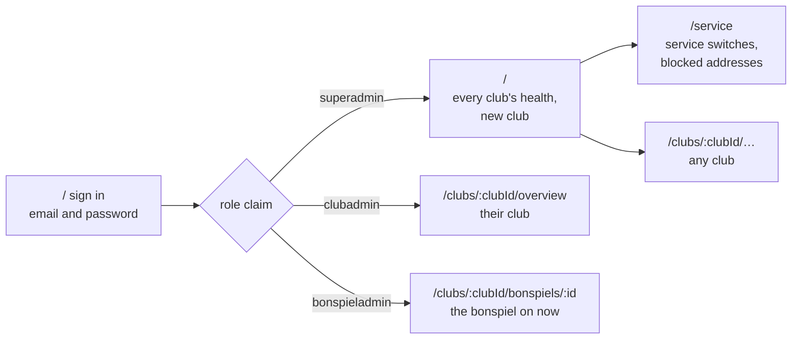
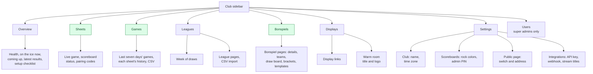

# Admin portal

The React app club staff and super admins manage everything in. Part of the
[architecture docs](../ARCHITECTURE.md). The code is in
[`admin/`](../../admin/), whose README maps its folders.

## Routes

Every role uses the same paths for a club's pages, so a link a club admin
sends opens the same page for a super admin. The role decides where `/`
goes and which of a club's pages it can open:

- Super admin: `/` is the overview of every club, and creates new ones.
  `/service` has the service switches and blocked addresses. They can open
  any club, from the overview or from the club switcher in the top bar.
- Club admin and bonspiel admin: `/` goes to their own club. Club admins,
  and super admins opening a club, land on its Overview. Bonspiel admins land
  on the bonspiel on today, or else the next to start, or else the list of
  bonspiels. Bonspiel admins cannot read the club's time zone, so "today" is
  the browser's date. A club path for any other club goes back to `/`.
- Inside a club, `/clubs/:clubId/` and then:
  - `overview`, `sheets`, `games`, `leagues`, `bonspiels`, `displays`,
    `devices`: the club's pages.
  - `settings/club`, `settings/scoreboards`, `settings/public-page`,
    `settings/integrations`: its settings.
  - `users`: super admins only.
  - `sheets/:sheetId/games`, `leagues/:leagueId`, `bonspiels/:bonspielId`: a
    sheet's game history, a league and a bonspiel.
- Links from before the shared paths still work: the club admin's
  `/sheets/:sheetId/games`, `/leagues/:leagueId` and `/bonspiels/:bonspielId`,
  and the old `?tab=` and `?section=` query, redirect to the new paths.
  `src/lib/clubPaths.ts` holds the paths and the redirects.
- Anyone, signed in or not: `/help` lists the guides for club admins and
  `/help/:guide` shows one. See [Help](#help).

## The club's pages

Bonspiel admins see only the three green pages.

A club's pages are listed in a sidebar beside the page open. On a window
narrower than 800 pixels the sidebar is a menu, opened from a bar at the top
of the page. Super admins get a link back to every club at the top of it,
and their own pages, marked in purple, at the bottom. Bonspiel admins only
get Sheets, with nothing to change and no pairing codes, Games, and
Bonspiels; the other pages are not mounted for them at all.

- **Overview**: the club at a glance. The scoreboards' health in one line,
  then what is on the ice now: the league or bonspiel draw on, and each
  sheet's live score. Beside it, the draws coming up in the next week, the
  last five finished games, and a setup checklist: sheets, a scoreboard on
  every sheet, the time zone, the scoreboard PIN, a league or bonspiel, and,
  optional, the public scores page and posting results to chat. Each step
  opens the page that does it. What is on now is worked out in
  `src/lib/clubNow.ts`, in the club's time zone, with the same lead time as
  the scoreboard and the API.
- **Sheets**: a card for each sheet with its live game, scoreboard status
  and pairing code, the code large enough to read from the sheet. Each
  sheet opens its full game history.
- **Games**: the games from the last seven days, and a button for each
  sheet's full history. Both export as CSV, a row a game with each team's
  total and points by end, for keeping league standings.
- **Leagues**: the club's leagues, with a week laid out as a calendar of
  their draws that flags active leagues whose draws overlap. Each league opens on its
  own page: its season, draws and teams, by hand or by
  [CSV import](leagues.md#leagues).
- **Bonspiels**: the club's bonspiels, newest first. Each opens on its own
  page: its details, events and teams (typed, or pasted one to a line), and
  a draw board with the draws down the side and the sheets across. Tapping a
  game sets its teams and its result; tapping an empty cell adds one. The
  board shows each game as the functions last worked it out, with the edits
  not yet saved laid over it. Beside it, Brackets shows each event in
  rounds, a game's round being one past the latest game in the event its
  winners come from, ending at the final and the event's winner. A pool
  shows its standings and its games instead, and where teams share a place
  the coordinator orders them with Move up, which saves as the event's
  `tiebreak`. On each of the bonspiel's days, **Today** comes first, above
  the details: the day's draws in order with the one on now marked (from
  `bonspielDay` in `src/lib/clubNow.ts`, with the same lead time as the
  scoreboard), each game's live score from its sheet, and **Needs a hand**,
  for a tie or a game on a sheet with no scoreboard. Its times are the
  browser's clock, since bonspiel admins cannot read the club's time zone.
  Duplicate
  copies a bonspiel's events, draws and games to new dates, without its teams
  or results, to run it again. The knockout and pools templates fill a
  bonspiel in from a list of teams; see [Bonspiels](bonspiels.md#templates).
- **Displays**: the display links, and the warm room screen's title and
  logo. A link can show the warm room, a sheet's score bug or one of the
  club's bonspiels.
- **Settings**, a page each:
  - Club: the club's name, which only super admins can change, and its time
    zone.
  - Scoreboards: the rock colors and the scoreboard admin PIN.
  - Public page: the switch for the public scores page, with its address.
  - Integrations: the API key with the club's API switch, the completed
    game webhook, which once saved is shown in short until it is edited, and
    the stream titles.
- **Devices**: every scoreboard and display screen with all it last
  reported (version, build, platform, clock, last sync error), and whether
  the club's API, public page and webhook are working. **Copy report** puts
  a plain text summary, with times in UTC, on the clipboard for an issue or
  a message. Read only, for club admins and super admins.
- **Users**: super admins only. Adds, edits and removes the club's club and
  bonspiel admins. Club admins see the same list, read only, under Club
  settings.

Every one of these pages stays mounted while another is shown, so a half-made
change survives moving between them. Opening a sheet's games, a league or a
bonspiel leaves them, so the portal asks first if anything is unsaved.
While any setting has unsaved changes, a save bar is pinned to the bottom of
the club's pages, naming each one (the time zone, the rock colors, the
webhook, the stream titles, the warm room title and logo), even from a page
moved away from, with one **Save** and one **Discard** for them all. Each
section keeps its own Save too. A setting that cannot be saved yet, such as
a webhook with a bad URL, is left alone and named. Editors join the bar by
passing their save and discard to `useUnsavedChanges` in
`src/lib/unsavedChanges.ts`; a league and a bonspiel keep their own sticky
save header instead. Only
super admins can add sheets, rename the club, rotate the key or add club
admins, and the portal tags what only they see. (The rules would let a club
admin write their club's sheets; the portal just doesn't offer it.)

A super admin in a club sees a purple bar saying so, with **See it as**:
Super admin, Club admin or Bonspiel admin. The last two show the sidebar
and pages as that role has them, so a super admin can see what a club's
admins see while helping them. It changes only what is shown: the rules
still treat them as a super admin.

Each page links to its guide beside its title. The link opens in a new tab,
like Help in the top bar, so a half-made change is not lost.

## Super admin pages

Super admins share one set of listeners over every club, set up in
`src/hooks/useSystemData.tsx`: the clubs, every club's sheets and display
links through collection group queries, the deployed builds, and the
service switches. The rules let super admins read all of it.

- **Overview** (`/`): counts across every club (clubs, scoreboards online,
  paired but offline, sync errors today, games on now), then **Needs a
  look**, each scoreboard with a sync error, offline, behind or with its
  clock out, and each open screen that is behind, worst first, each linked
  to its club's Devices. A closed screen is no problem, since screens are
  switched off between events. Below, every club with its sheets, scoreboard
  health, games on now and screens open, clubs with problems first.
  `src/lib/systemHealth.ts` works these out.
- **New club** (`/new-club`): three steps, the club (name, ID, time zone and
  how many sheets), its first admin, then a check. The portal makes the
  admin's password and a six digit scoreboard PIN, which can be typed over,
  calls `provisionClub`, then writes the time zone and the sheets. It ends
  on the message to send the admin, with how to sign in and the PIN.
  Adding a user under a club's Users makes a password the same way and
  shows the same message. Passwords are 16 characters from
  `generatePassword` in `src/lib/credentials.ts`, leaving out characters
  that are easy to misread.
- **Service controls** (`/service`): the switches and blocked addresses.
  While any switch is off, a red bar under the top bar says so on every
  page.
- **Club switcher**: in the top bar, or ⌘K (Ctrl K). Type part of a club's
  name or ID; each club shows its health, and the best match offers its
  Devices, Users, Sheets, Bonspiels and Settings.
- The sidebar on these pages lists the three clubs opened last, kept in the
  browser's local storage.

## Look

Every color is a token in `src/styles/tokens.css`, with a dark value used
when the computer is set to dark mode; there is no switch in the portal.
Stylesheets use the tokens and never a literal color, apart from the top
bar and the sign in page, which are dark in both, and previews of a real
screen or rock. The meanings hold in both: green is well, amber needs a
look, red is broken, and purple is for super admins only.

Every page opens with the same header, `src/components/PageHeader.tsx`: its
title, a line under it when there is one, its guide, and the buttons for
the page as a whole.

## Help

The help pages are the Markdown guides in
[`docs/guides/`](../guides/README.md), read into the portal when it is built
with Vite's `import.meta.glob`. They always match the build they ship in, and
a change to a guide reaches the portal on the next deploy, dev on a merge and
prod on a release. The guides' README is the page at `/help`, and its table
sets the order of the list beside each guide.

`src/lib/helpMarkdown.ts` turns a guide into HTML with `marked`, the way
GitHub shows it: headings get GitHub's ids, so a link to a heading works in
both places. A link to another guide stays in the portal; a link to anything
else in the repo, such as these architecture pages, opens on GitHub. The help
pages need no sign-in, so a link to one can be sent to someone without an
account; the sign-in page links to them too.
