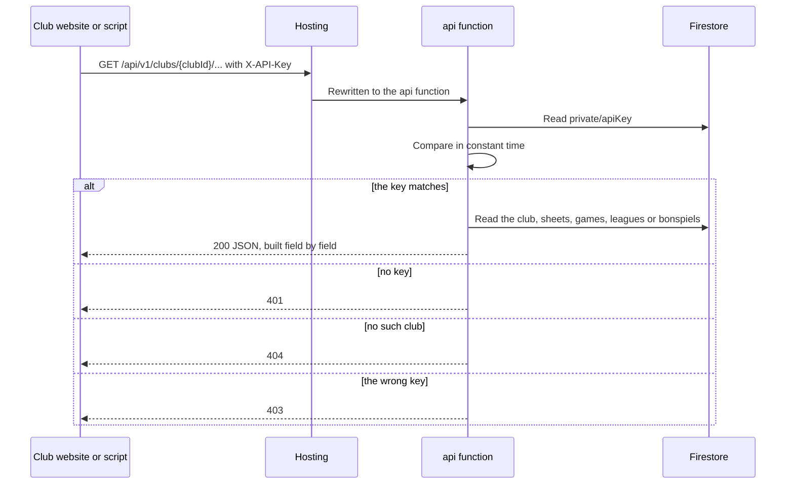
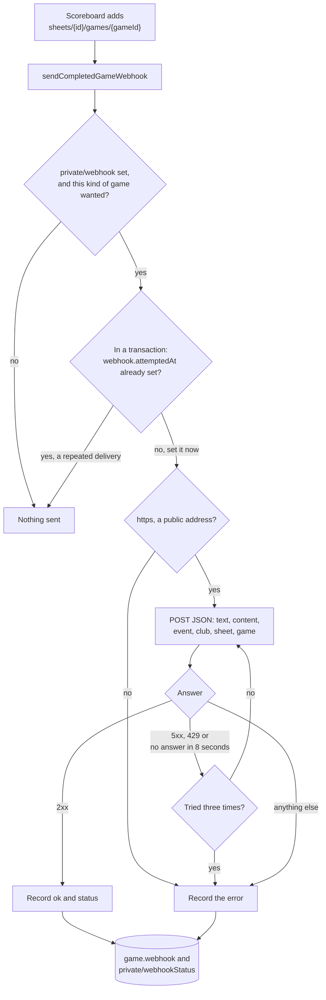

# REST API and webhook

The two ways a club's own systems get its games: asking the read only REST
API, or being sent each completed game. Part of the
[architecture docs](../ARCHITECTURE.md).

## Public REST API

The `api` function is an Express app, served on the scoreboard's hosting site
under `/api/**` through a Hosting rewrite. It is read only:

- `GET /api/v1/clubs/{clubId}`
- `GET /api/v1/clubs/{clubId}/sheets/{sheetId}`
- `GET /api/v1/clubs/{clubId}/sheets/{sheetId}/games?limit=`
- `GET /api/v1/clubs/{clubId}/leagues`
- `GET /api/v1/clubs/{clubId}/leagues/{leagueId}`
- `GET /api/v1/clubs/{clubId}/bonspiels`
- `GET /api/v1/clubs/{clubId}/bonspiels/{bonspielId}`

Live and completed games carry `league` (null for an open game) and, in a
league game, each team's `teamId` and `externalId`, which match the teams the
league endpoints return. A bonspiel game carries `bonspiel`, naming the game
in its bonspiel's plan, which the bonspiel endpoint returns with each
game's teams worked out, its score and where each side comes from, and each
pool's standings. A live game also carries `numberOfEnds` and the
`ends` played so far, in the same form as a completed game's; both are null
for a game from a scoreboard build that predates them.

Every request needs the club's key in the `X-API-Key` header, compared in
constant time against `clubs/{clubId}/private/apiKey`. The full description is
`app/web/openapi.yaml`, rendered at `/api-docs/` on the same site.

Club websites and display pages are expected to call the API from the
browser, so it allows any origin (`Access-Control-Allow-Origin: *`) for `GET`
with the `X-API-Key` header, never with credentials, and lets browsers cache
the preflight for a day. A key used in browser code is visible to anyone who
views the page; an integration that needs to keep its key private should call
the API from a server.

## Completed game webhook

A club can have each finished game posted to a URL, usually a Slack or
Discord incoming webhook. A club admin or super admin sets it under Settings,
Integrations in the admin portal, along with whether to post every game, only league
games or only bonspiel games. A league game here is one where either team has a
`teamId` and that is not a bonspiel game.

`sendCompletedGameWebhook` is a Firestore trigger on new `games` documents, so
it fires on the Finish Game write and nothing in the scoreboard app knows
about it. A game nobody finishes is never posted, and a scoreboard that was
offline posts its games when it reconnects.

The body is JSON: `text` and `content` both hold the message, because Slack
reads the first and Discord the second, followed by `event`, `club`, `sheet` and the
`game` exactly as the REST API returns it. It is described under Webhooks in
`app/web/openapi.yaml`.

- **Quiet on Discord.** Every post carries `flags: 4096`, Discord's
  `SUPPRESS_NOTIFICATIONS`, so results land in the channel without buzzing
  anyone's phone, and `allowed_mentions: { parse: [] }`, so an `@everyone`
  or role mention typed into a club's template pings nobody. Slack ignores
  both.
- **Message.** The club can write its own message in the portal, with
  variables in braces such as `{team1}`, `{league}` or `{date}`, filled in by
  `functions/src/webhookMessage.ts`. Without one it is the result on one line
  ("Monday Night, Sheet 2: Team Smith 7, Team Jones 4"), or for a bonspiel
  game its bonspiel and game ("Fall Spiel A7, Sheet 2: ..."). `{bonspiel}`,
  `{bonspielGame}` and `{event}` come from the bonspiel's plan. Dates and times are
  written in the time zone saved with the template, which the portal
  defaults to the admin's own. `{date}`, `{shortDate}` and `{weekday}` are
  the day the game started, so a late draw that runs past midnight keeps
  the night it was played; `{finishDate}` is the day it ended. A name in braces that is not a variable is
  posted as written, and the portal warns about it. The portal lists the
  variables with sample values for its preview in
  `admin/src/lib/webhookMessage.ts`, so a new variable goes in both.
- **Once per game.** Triggers can be delivered more than once, so the function
  sets `webhook.attemptedAt` on the game in a transaction before posting and
  skips a game that already has it. A post that fails is not sent again later.
- **Retries.** No answer within 8 seconds, a 5xx or a 429 is tried twice more
  within the same run. Other answers are final.
- **Where it may post.** The URL comes from a club admin and the request is
  made from inside Google Cloud, so it must be `https`, must resolve to a
  public address, and redirects are not followed. The functions emulator
  skips these checks so the tests can post to a local server.
- **Status.** The outcome of each post (`ok`, the HTTP `status`, any `error`)
  is written to the game's `webhook` field, which the portal shows when a
  game is expanded, and marks on the game's row when it failed. The last
  post, game or test, is also written to `private/webhookStatus` for the
  portal's settings. That is a separate document so the rule on `private/webhook`
  can allow club admins exactly the settings they choose. The REST API leaves the
  game's `webhook` field out.

The portal's Send Test button calls `sendTestWebhook`, which posts a sample
message to the saved URL, with the club's template filled in for a made up
game, and returns how it went. The URL is treated like a
password: it lives under `private`, which scoreboards cannot read, and the
portal shows it masked once saved.
