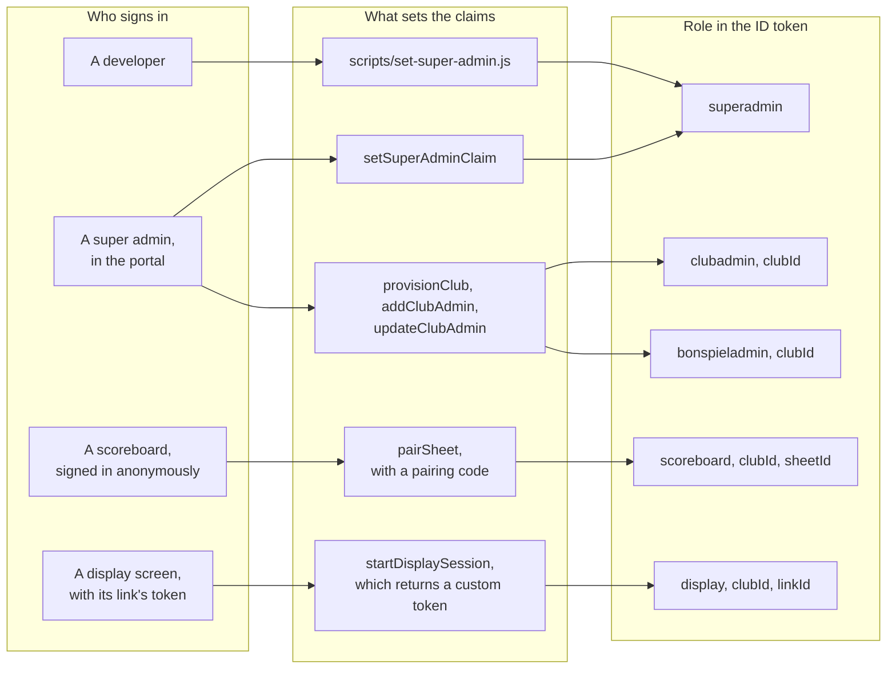

# Auth and roles

Who can sign in, how each gets its role, and what `firestore.rules` lets each
read and write. Part of the [architecture docs](../ARCHITECTURE.md).

## Roles

Roles are Firebase Auth custom claims, set only by Cloud Functions or the
admin scripts.

The way back out: `removeClubAdmin` deletes an admin's account,
`unpairSheet` clears a scoreboard's claims, and `revokeDisplayLink` deletes a
link's Auth user.

| Role              | Claims                                    | Signs in with                           | Can                                                                                                                                                                                                                                                                       |
| ----------------- | ----------------------------------------- | --------------------------------------- | ------------------------------------------------------------------------------------------------------------------------------------------------------------------------------------------------------------------------------------------------------------------------- |
| Super admin       | `role: 'superadmin'`                      | Email and password                      | Everything: create clubs and club admins, add and delete sheets, rotate API keys, read and write all data                                                                                                                                                                 |
| Club admin        | `role: 'clubadmin'`, `clubId`             | Email and password                      | Their club: read it and its API key, rename sheets and generate and clear pairing codes, set the rock colors, the completed game webhook and the scoreboard admin PIN, manage leagues and teams, plan bonspiels, manage display links, the warm room branding and the public scores switch, read game history |
| Bonspiel admin    | `role: 'bonspieladmin'`, `clubId`         | Email and password                      | Their club: read it, its sheets and their game history, and plan its bonspiels. Changes nothing else                                                                                                                                                                       |
| Paired scoreboard | `role: 'scoreboard'`, `clubId`, `sheetId` | Anonymous                               | Its own sheet: read it, write `liveGame` and `device`, add completed games. Its club: read `config`, `leagues`, and `bonspiels` with their state                                                                                                                           |
| Display           | `role: 'display'`, `clubId`, `linkId`     | Custom token from `startDisplaySession` | Its club: read `private/displayState`, `private/displayBranding`, and `bonspiels` with their state; read its own link and write its `device`                                                                                                                              |
| Anyone            | —                                         | —                                       | Read `appConfig/scoreboard` and `appConfig/displays`. Without signing in at all: open the display pages (which then need a link's token), a club's public scores page once it is turned on, and the REST API with a club's key                                          |

## What the rules allow

Super admins can read and write everything, through a rule that matches every
document. The rest, path by path, under `clubs/{clubId}`:

| Path                        | Club admin                              | Bonspiel admin      | Paired scoreboard                         | Display                         |
| --------------------------- | --------------------------------------- | ------------------- | ----------------------------------------- | ------------------------------- |
| the club document           | read                                    | read                | —                                         | —                               |
| `private/apiKey`            | read                                    | —                   | —                                         | —                               |
| `private/scoreboardPin`     | read, write (4 to 8 digits)             | —                   | —                                         | —                               |
| `private/webhook`           | read, write, delete                     | —                   | —                                         | —                               |
| `private/webhookStatus`     | read                                    | —                   | —                                         | —                               |
| `private/displayState`      | read                                    | —                   | —                                         | read                            |
| `private/displayBranding`   | read, write, delete                     | —                   | —                                         | read                            |
| `private/publicScores`      | read, write                             | —                   | —                                         | —                               |
| `displayLinks/{linkId}`     | read; change `label` and `settings`     | —                   | —                                         | its own: read; write `device`   |
| `admins/{uid}`              | read                                    | —                   | —                                         | —                               |
| `config/scoreboard`         | read, write                             | —                   | read¹                                     | —                               |
| `leagues/{leagueId}`        | read, write, delete                     | —                   | read¹                                     | —                               |
| `bonspiels/{bonspielId}`    | read, write, delete                     | read, write, delete | read¹                                     | read                            |
| `bonspiels/{id}/state/*`    | read                                    | read                | read¹                                     | read                            |
| `sheets/{sheetId}`          | read, write                             | read                | its own: read; write `liveGame`, `device` | —                               |
| `sheets/{id}/games/{id}`    | read                                    | read                | its own sheet's: create                   | —                               |

¹ Only while one of the club's sheets still names that scoreboard in
`scoreboardUid`.

Writes are also held to a shape: the PIN to digits, the webhook to an
`https` URL and the settings the portal offers, a display link's settings to
what the pages understand, the logo to a PNG, JPEG or WebP data URL, and
leagues and bonspiels to their outline. Every rule has cases in
`emulator-tests/rules.test.mjs`.

## Scoreboard access

A scoreboard's claims only tell the rules which sheet to look at. Access to
its sheet has always been decided by the sheet's `scoreboardUid`, and reading
the club's `config`, `leagues` and `bonspiels` needs both: the claims and a
sheet that still names that scoreboard. So a scoreboard that is disconnected or replaced loses access
straight away, whatever its claims say.

## Managing accounts

The first super admin of a project is created with
`scripts/set-super-admin.js`; after that, `setSuperAdminClaim` promotes
others. Club and bonspiel admins are created from the admin portal through
`provisionClub` (a new club with its first admin and scoreboard PIN) and
`addClubAdmin`, changed with `updateClubAdmin` (name, email, role and a new
password), and taken off again with `removeClubAdmin`, which deletes the
account. Each is listed in the club's `admins` collection with its `role`.
`updateClubAdmin` revokes the user's refresh tokens when it changes their role
or password, so the portal signs them out. A token issued before a removal or
a change of role keeps its old claims until it expires, at most an hour later.

## Sheets

Sheets are renamed and unpaired by writing the sheet directly. Deleting one
goes through `deleteSheet` (super admins only), which also deletes its
`games`, since a client delete would leave them behind.

## API keys and display links

Two kinds of access do not use Firebase Auth roles at all:

- The REST API checks the club's API key in the `X-API-Key` header against
  `private/apiKey`. See [REST API and webhook](api-and-webhook.md#public-rest-api).
- The public scores page needs no sign-in and reads nothing itself; the
  `display` function reads for it. See [Displays](displays.md#public-scores-page).

Display links are how a screen with nobody to sign in gets the display role.
See [Displays](displays.md#display-links).
