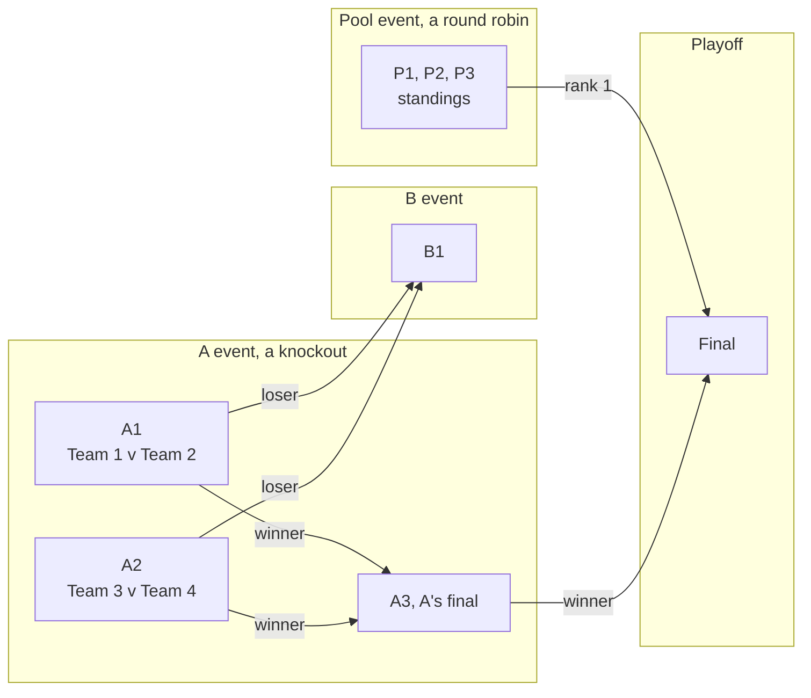
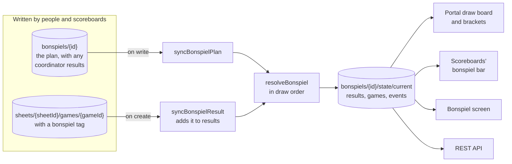
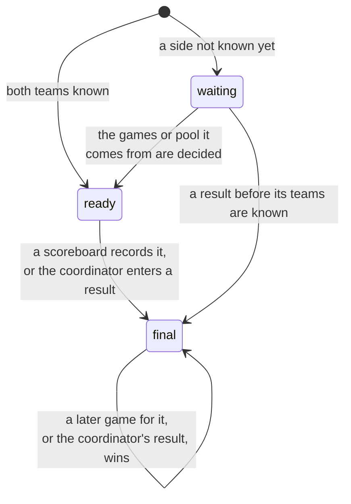

# Bonspiels

How a bonspiel is planned, how the functions work out who plays whom, and how
its games are started on the scoreboards. Part of the
[architecture docs](../ARCHITECTURE.md).

## Plans

A bonspiel runs over a few days, with up to 32 teams. The draw times and
sheets are known ahead, but most of the teams in a game come out of the
games before it. The format changes from one bonspiel to the next, so none is
stored: the plan is a list of games, and each side of a game says where its
team comes from. A side is a team placed by the coordinator, the winner or
loser of a game in an earlier draw, or to be decided. A knockout's A, B and C
events, games placed by hand, and anything in between are all written that
way. An event's final is its one game whose winner goes to no other game in
the event, and the final's winner wins the event. Nothing has to mark it.

Each arrow is a side of the game it points to: `{ from, result }` for a
game's winner or loser, `{ rank, eventId }` for a place in a pool. A1 and A2
have placed teams, `{ teamId }`. A3 is A's final because its winner goes to
no other game in A.

An event with more than one such game is a pool, played as a round robin
or any other way, and its standings decide it. A side can be a place in a
pool's standings, `{ rank, eventId }`, which is how pools send their top
teams on to a playoff. Teams are ranked by points, two for a win and one for
a tie; teams level on points by the points from the games between them;
and teams level still by the event's `tiebreak`, an order of team IDs the
coordinator sets after a last stone draw or a tiebreak game. Teams the
tiebreak does not order share a place. A place only sends its team on once
every game in the pool has a result and nobody shares it.

## Planning in the portal

Club admins and bonspiel admins plan bonspiels on the portal's Bonspiels tab.
The portal saves the whole plan at once, after checking that it makes sense:
every game is in a draw and an event and on one of the club's sheets, one
game to a sheet in each draw, no team twice in a draw, a game only comes from
games in earlier draws, and no game's winner or loser, or pool's place, goes
to two games. A place in a pool comes from a pool whose games are all in
earlier draws.
The rules only check the plan's outline, as they do for leagues.

## State

Each bonspiel's state, who is in each game and how it went, is kept apart
from the plan in `state/current`, and only the functions write it. A
coordinator saving the plan then never overwrites a result that has just
come in, or the other way round, and the bracket is worked out in one place.
`resolveBonspiel` in `functions/src/bonspiels/state.ts` works it out in draw
order: a placed team is that team, a side from another game is that
game's winner or loser once it has one, and a place in a pool is the team
in it once the pool is played. A game's result is the coordinator's,
if there is one, otherwise the latest game a scoreboard recorded for it. A
scoreboard's result also says who actually played, which wins over the plan,
so a game played by other teams after a last minute change still sends the
right teams on. A tied game sends nobody on until the coordinator says who
won. A game that refers to one that does not exist, or to itself, is left
waiting rather than failing the bonspiel.

Each game in the state goes from waiting to ready to final:

A final game with no winner is `tied`, and sends nobody on until the
coordinator enters who won.

Two functions in `functions/src/bonspiels/triggers.ts` rebuild the state in a
transaction:

- `syncBonspielPlan` on every write to a plan. A deleted plan takes its
  state with it.
- `syncBonspielResult` on each completed game that carries a bonspiel tag,
  `bonspiel: { id, name, gameId }`, adding it to the state's `results`
  unless a later game is already kept for that bonspiel game. Other games
  are let go without a read.

Like the display summary, both rebuild from the documents as they are, never
from the event, so a late or repeated delivery writes the same thing again.

Hammer is not part of a plan: it stays a choice on the scoreboard, as in any
other game.

## On the scoreboard

`BonspielService` follows the paired club's active bonspiels and, for each,
the games of its state: one listener on the bonspiels and one per bonspiel,
like `LeagueService`. It keeps the last it saw in shared preferences, so a
scoreboard that starts offline on a bonspiel weekend still has them.

On a bonspiel's dates, the setup screen's league bar gives way to a
bonspiel bar offering this sheet's game in the current draw. A draw is
current from 30 minutes before it starts, the league lead time, until the
same time before the next; before the first draw it is the first. The game's
teams are those the state has worked out, or those the coordinator placed,
and a side still to come shows where it comes from ("Winner of A3", "Pool
A #1"), filling
in as the state changes. Start Game starts it, to its event's number of ends
unless others are picked. A bonspiel game's result only counts with its
teams, so a game with a side not known yet asks for the teams first, in the
league team picker: the teams of the games or pool it comes from first, or else
those not in another game of the draw, and every team behind a button.

The bar's left side opens a chooser with this sheet's games from the draw
before the current one on, the current draw's games on other sheets, for a
game moved at the last minute, and a way to league games, whose chooser
leads back. Its cross sets the game aside for an open game.

The game carries `bonspiel: { id, name, gameId }` and each team's `teamId`
and `externalId` in `liveGame` and its completed game, which is what
`syncBonspielResult` reads. During the game the Teams button picks its
teams again, offering its own and those free in its draw first. The REST
API returns the tag as each game's `bonspiel`, and the completed game
webhook does not count a bonspiel game among league games, although its
teams have IDs.

## Templates

Two templates fill in a plan for the coordinator, in the portal's template
dialog. Both are in `admin/src/lib/bonspielTemplates.ts`.

The knockout template fills a bonspiel in from scratch: up to 64 teams in
one to four events. Where losers go is one of three rules:

- **Four event, by size**, the draw clubs have long laid out by hand and the
  default: A's losers, earliest first, fill B to half the field and then C to
  a quarter, and B's earliest losers fill D to a quarter. Any other loss ends
  a team's bonspiel. With B, C and D filling early, every final can be played
  in the last draw.
- **By A round**: A round 1's losers make up B, round 2's C, and so on. A loss
  in any other event ends a team's bonspiel.
- **Down one event**: a loss in any event drops a team to the next, A to B
  and B to C, and a loss in the last ends it: the triple knockout.

The loser of an event's final is its runner up and goes nowhere. Each event
is built round by round, as teams reach it,
with byes for the teams listed first once no more are coming, so no team
has two. `knockoutPlan` in `admin/src/lib/bonspielTemplates.ts` then places
the games in draws, those whose teams have waited longest first, never
before the games they come from, never with a team twice in a draw and,
where other games can fill the draw, not in the draw right after them. Draws
start at the first draw's time and are spaced by the minutes between draws;
each later day starts at its own time and stops by the last draw's.

The pools template, `poolsPlan`, splits the teams into up to eight pools,
each a round robin, and sends the top one to three of each pool to a
knockout playoff ending in one final: first places meet the other pools'
lowest qualifiers, and the best seeds get any byes. What either template
makes is an ordinary plan, edited like any other.
