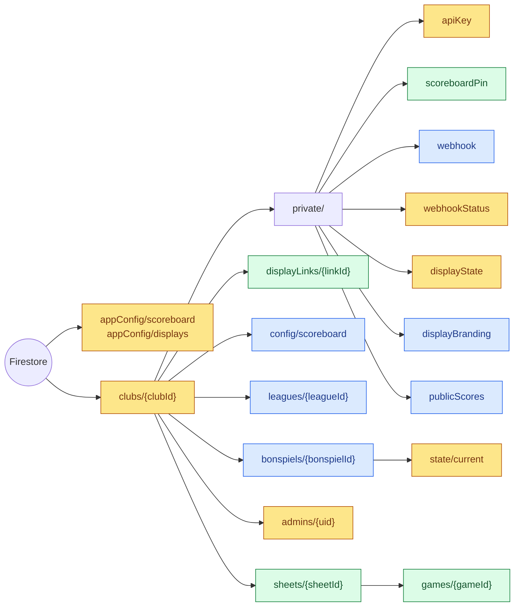

# Data model

Every document in Firestore, what is in it and who writes it. Part of the
[architecture docs](../ARCHITECTURE.md).

## Collections

The same layout in both projects. Colors show who writes each document:
the clients directly (through `firestore.rules`), or only the Cloud
Functions and admin scripts.



- **Blue**, written by clients: club admins and bonspiel admins in the
  portal, within what the rules allow.
- **Yellow**, written only by the functions, the deploy workflows
  (`appConfig`) or the admin scripts.
- **Green**, written by both. `provisionClub` sets a club's first scoreboard
  PIN and its admins change it. A display link is created by
  `createDisplayLink`, its label and settings changed in the portal, and its
  `device` written by its screen. A sheet is named and given pairing codes
  in the portal, has its `scoreboardUid` set by `pairSheet`, and has its
  `liveGame` and `device` written by its scoreboard. A game is added by the
  scoreboard, and its `webhook` field set by `sendCompletedGameWebhook`.

Super admins can read and write everything, which the portal uses to rename
clubs, add sheets and rotate API keys. Those writes are left out above.

## Fields

```
appConfig/scoreboard
  buildId: string            // commit SHA of the deployed web build
  deployedAt: timestamp

appConfig/displays
  buildId: string            // commit SHA of the deployed functions, and so
  deployedAt: timestamp      // of the display pages

clubs/{clubId}
  name: string

clubs/{clubId}/private/apiKey
  key: string                // 32 hex characters

clubs/{clubId}/private/scoreboardPin   // asked for to disconnect a scoreboard
  pin: string                // 4 to 8 digits

clubs/{clubId}/private/webhook       // absent means no webhook
  url: string                // https, where completed games are posted
  games: 'all' | 'league' | 'bonspiel'   // every game, only league games, or only bonspiel games
  template?: string          // the club's message, up to 1000 characters; absent for the default
  timeZone?: string          // IANA zone for dates in the message; absent means UTC

clubs/{clubId}/private/webhookStatus // the last post, written by the functions
  at: timestamp
  kind: 'game' | 'test'
  ok: bool
  status?: int               // the receiver's HTTP status, if it answered
  error?: string

clubs/{clubId}/private/displayState  // what the display pages show, written by the functions
  sheets: {
    [sheetId]: {
      name: string
      live: {                // the live game, or null; see liveGame below
        updatedAt: timestamp | null
        currentEnd: int
        numberOfEnds: int | null           // null from scoreboard builds before it was sent
        league: { name: string } | null
        bonspiel: { id: string, name: string, gameId: string } | null   // a bonspiel game's
        team1: { name: string, color: { name, hex } | null, score: int,
                 hasHammer: bool | null, hadLastStoneFirstEnd: bool | null }
        team2: { ...the same }
        ends: [{ endNumber: int, scoringTeamSlot: 'team1' | 'team2' | null, score: int }] | null
      } | null
    }
  }
  results?: [{               // games finished in the last day, the latest first, at most 48;
                             // each sheet's latest is its final score
    gameId: string
    sheetId: string
    sheetName: string        // the sheet's name when the game finished
    startedAt: timestamp | null
    finishedAt: timestamp
    numberOfEnds: int | null
    endsPlayed: int          // the last end played; 0 when none were recorded
    league: { name: string,
              draws: [{ day: int, start: string, end: string }] } | null   // its league's draws, as the league had them
    bonspiel: { ...as in live } | null
    team1: { ...as in live, with hasHammer null }
    team2: { ...the same }
    ends: [...as in live]
  }]

clubs/{clubId}/private/displayBranding // the warm room screen's title bar; absent for the default
  title?: string             // up to 60 characters, in place of "Live Scores"
  logo?: string              // a PNG, JPEG or WebP data URL, up to 250,000 characters

clubs/{clubId}/private/publicScores // the public scores page's switch; absent when off
  enabled: bool              // set by club admins in the portal

clubs/{clubId}/displayLinks/{linkId} // what a display screen signs in with
  label: string              // up to 60 characters, e.g. "Warm room TV"
  secretHash: string         // SHA-256 of the token's secret, in hex, which sign-in checks
  token?: string             // the token itself, for the portal to show; absent on links made before it was kept
  settings: {                // what the link's screens show
    page: 'bug' | 'warm-room' | 'bonspiel'
    sheetId?: string         // the score bug's sheet
    bonspielId?: string      // the bonspiel screen's bonspiel
    view?: 'totals' | 'full' | 'cycle'   // the warm room's; totals when absent
         | 'now' | 'schedule' | 'brackets' | 'cycle'   // the bonspiel screen's; now when absent
    every?: int              // seconds on each view when they take turns, 5 to 300; 20 when absent
    scale?: number           // the score bug's size, 0.5 to 4; 1 when absent
    label?: 'sheet' | 'league' | 'both' | 'none'  // the score bug's caption; sheet when absent
    end?: 'left' | 'right'   // the side of the score bug its end box is on; right when absent
    earlier?: bool           // the warm room's earlier results beside the sheets; not when absent
  }
  createdAt: timestamp
  lastUsedAt?: timestamp     // when a display last started with it, at most hourly
  device?: {                 // what the screen on it last said about itself; the
                             // last to report, when it is open on more than one
    appVersion?: string      // release, from app/pubspec.yaml at the deploy
    buildId?: string         // commit SHA; absent on local builds
    page: 'bug' | 'warm-room' | 'bonspiel' | 'link'
    sheetId?: string         // the score bug's sheet
    lastSeenAt: timestamp    // server time of the report
    sessionStartedAt: timestamp
    clientTime: timestamp    // the device's own clock
    userAgent: string
    screen: { width: int, height: int, pixelRatio: number }
    timezone: string
    utcOffsetMinutes: int
    updateTargetBuildId?: string
    lastReloadAttemptAt?: timestamp
  }

clubs/{clubId}/config/scoreboard     // club settings the scoreboards read
  rockColors?: {             // absent means red and yellow
    team1: { name: string, hex: string }   // hex is '#RRGGBB'
    team2: { name: string, hex: string }
  }

clubs/{clubId}/leagues/{leagueId}
  name: string
  active: bool               // inactive leagues are not offered on scoreboards
  seasonStart?: string       // 'YYYY-MM-DD', inclusive
  seasonEnd?: string
  draws: [{                  // when it plays each week, in the club's local time
    day: int                 // 1 (Monday) to 7 (Sunday)
    start: string            // 'HH:mm', 24 hour
    end: string
  }]
  teams: [{
    id: string               // stable across renames and imports
    name: string
    externalId?: string      // the team's ID in the club's own league software
  }]

clubs/{clubId}/bonspiels/{bonspielId}  // a bonspiel's plan, written by its coordinators
  name: string
  active: bool
  startDate: string          // 'YYYY-MM-DD', the club's local time, inclusive
  endDate: string
  numberOfEnds: int          // 1 to 12, for every game unless its event says otherwise
  events: [{
    id: string
    name: string             // "A Event"
    numberOfEnds?: int
    tiebreak?: string[]      // a pool's team IDs, in the order that breaks its ties
  }]
  teams: [{ id: string, name: string, externalId?: string }]
  draws: [{
    id: string
    label: string            // "Draw 5"
    start: string            // 'YYYY-MM-DDTHH:mm', the club's local time
  }]
  games: [{
    id: string               // random; never shown, so the label can change
    label: string            // "A7"
    drawId: string
    sheetId: string
    eventId: string          // every game is in exactly one event
    team1: Side              // throws the first rock color
    team2: Side
    result?: {               // the coordinator's; wins over a scoreboard's
      winner: 'team1' | 'team2'
      team1Score?: int
      team2Score?: int
    }
  }]
  // Side is { teamId } (placed), { from: gameId, result: 'winner' | 'loser' }
  // (out of an earlier game), { rank: int, eventId } (a place in a pool's
  // standings, from 1), or null (to be decided).

clubs/{clubId}/bonspiels/{bonspielId}/state/current   // written by the functions
  updatedAt: timestamp
  results: {                 // the latest game a scoreboard recorded for each game
    [gameId]: {
      sheetId: string
      sheetGameId: string    // the games document under the sheet
      finishedAt: timestamp
      team1: { teamId?: string, name: string, score: int }
      team2: { ...the same }
    }
  }
  games: {
    [gameId]: {
      status: 'waiting' | 'ready' | 'final'
      team1: { teamId?: string, name: string } | null   // null until known
      team2: { ...the same }
      team1Score?: int
      team2Score?: int
      winner?: 'team1' | 'team2'
      tied?: true            // a result with no winner, so nobody goes on
      resultFrom?: 'coordinator' | 'scoreboard'
      sheetId?: string       // where a scoreboard's result came from
      sheetGameId?: string
    }
  }
  events: {
    [eventId]: {
      finalGameId?: string   // the event's one game whose winner goes nowhere else in it
      winner?: { teamId?: string, name: string }
      standings?: [{         // a pool's, best first
        teamId?: string
        name: string
        played: int
        wins: int
        losses: int
        ties: int
        points: int          // 2 a win, 1 a tie
        place: int           // from 1; teams sharing one have the same
        tied: bool           // shares its place
      }]
      complete?: bool        // a pool's: every game has a result
    }
  }

clubs/{clubId}/admins/{uid}          // written by the functions that manage accounts
  email: string
  displayName: string | null
  role: 'clubadmin' | 'bonspieladmin'   // absent on admins made before roles, meaning clubadmin

clubs/{clubId}/sheets/{sheetId}
  name: string
  pairingCode?: string       // set by an admin, removed once used
  scoreboardUid?: string     // the paired scoreboard's anonymous Auth uid
  pairedAt?: timestamp       // when that scoreboard paired
  liveGame?: {               // the game in progress, removed when it ends
    updatedAt: timestamp     // server time of the scoreboard's last write
    currentEnd: int
    numberOfEnds?: int       // absent from builds before it was sent
    league?: { id: string, name: string }   // league games only
    bonspiel?: { id: string, name: string, gameId: string }   // bonspiel games only
    team1: { name: string, color: { name, hex }, score: int, hasHammer: bool,
             hadLastStoneFirstEnd: bool,
             teamId?: string, externalId?: string }   // the last two in league games
    team2: { ...the same }
    ends?: [...as in games below]   // the ends so far; absent from builds before it was sent
  }
  device?: {                 // what the scoreboard last said about itself
    appVersion: string
    buildId?: string         // commit SHA; absent on local builds
    lastSeenAt: timestamp    // server time of the report
    sessionStartedAt: timestamp
    clientTime: timestamp    // the device's own clock
    platform: string         // 'web', 'android', ...
    renderer?: string        // web only: 'wasm' or 'js'
    userAgent?: string
    screen?: { width: int, height: int, pixelRatio: number }
    timezone: string
    utcOffsetMinutes: int
    updateTargetBuildId?: string
    lastReloadAttemptAt?: timestamp
    lastSyncError?: { operation: string, message: string, at: timestamp }
  }

clubs/{clubId}/sheets/{sheetId}/games/{gameId}
  startedAt: timestamp
  finishedAt: timestamp
  numberOfEnds: int
  league?: { id: string, name: string }     // league games only
  bonspiel?: { id: string, name: string, gameId: string }   // bonspiel games only; gameId is in its plan
  team1: { name: string, color: { name, hex }, totalScore: int, hadLastStoneFirstEnd: bool,
           teamId?: string, externalId?: string }     // the last two in league games
  team2: { ...the same }
  ends: [{
    endNumber: int
    scoringTeam: string | null       // team name; null for a blank end
    scoringTeamSlot?: 'team1' | 'team2' | null
    score: int
    gameTimeInSeconds: int           // -1 on ends recorded before the game clock
  }]
  webhook?: {                        // set once the game is posted to the club's webhook
    attemptedAt: timestamp
    ok?: bool                        // absent if the post never finished
    status?: int                     // the receiver's HTTP status, if it answered
    error?: string
  }
```

Club IDs are readable slugs (`windy-city-curling`) when the super admin picks
one, otherwise Firestore auto IDs. `scoringTeamSlot` was added because two
teams can share a name; older games only have `scoringTeam`. A team's `name`
is the name of its rock color in an open game and the league team's name in a
league game; `color` is absent on games from before it was recorded.

## Where game results live

The flow from the scoreboard's two writes to everything that shows a result
is drawn in [the life of a game](../ARCHITECTURE.md#the-life-of-a-game).

A finished game is recorded once, in the sheet's `games` document. Every
other copy of a result is made from it by a function, or is a bonspiel
coordinator's own entry, and each says where it came from:

| Where | What it holds | Written by | Read by |
| ----- | ------------- | ---------- | ------- |
| `sheets/{sheetId}/games/{gameId}` | The record: teams, ends, times, and whether the webhook was sent it | The scoreboard, once, at Finish Game | REST API, webhook, everything below |
| `sheets/{sheetId}.liveGame` | The game in progress, not yet a result | The scoreboard, on each change; removed at Finish Game | REST API, portal, `syncDisplaySheet` |
| `private/displayState.sheets[id].live` | A trimmed copy of `liveGame` | `syncDisplaySheet` | Display pages |
| `private/displayState.results` | The last day's games, trimmed, with their league's draws; each sheet's latest is its final score | `syncDisplayResults` | Display pages |
| `bonspiels/{id}/state/current.results` | A bonspiel game's latest scores from a scoreboard, pointing back to its `games` document | `syncBonspielResult` | `resolveBonspiel` |
| `bonspiels/{id}/state/current.games` | Each bonspiel game's result that counts, the coordinator's or the scoreboard's | `resolveBonspiel` | Portal, scoreboards, bonspiel screen, REST API |
| `bonspiels/{id}.games[].result` | The coordinator's own result, not a copy | Bonspiel coordinators, in the portal | `resolveBonspiel` |

Everything in the table made by a function can be made again from the
`games` documents: `scripts/backfill-display-state.js` does it for the
display summary, and a bonspiel's state is worked out again whenever its plan
or one of its games changes. Outside Firestore, the club's webhook receiver
keeps whatever it was sent, and each scoreboard's Firestore cache holds its
writes until they are sent.
