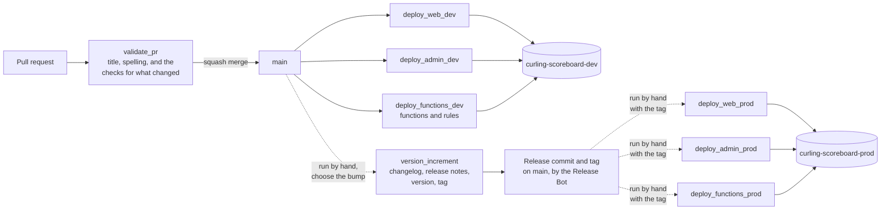
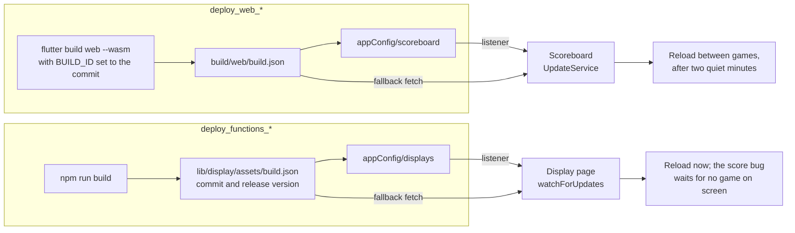

# Deploys and updates

<!-- cspell:ignore credentialless Embedder -->

How a change gets from a pull request to the clubs, and how scoreboards and
display screens that are never reloaded by hand pick it up. Part of the
[architecture docs](../ARCHITECTURE.md). The commands and workflow links are
under Deployments in the [README](../../README.md#deployments).

## From a pull request to prod

- **Pull requests.** `validate_pr` always checks that the title is a
  Conventional Commit and spell checks the repo. Each product's checks run
  only when its files, or the workflows that build or deploy it, changed.
  Nothing deploys from a pull request.
- **Dev.** Every push to `main` deploys all three products to
  `curling-scoreboard-dev`. Each deploy workflow is queued, so merges in quick
  succession never deploy over each other.
- **Prod.** `version_increment` reads the commits since the last release with
  `commit-and-tag-version`, writes `docs/CHANGELOG.md` and
  `docs/RELEASE_NOTES.md`, sets the version in `app/pubspec.yaml` and
  `app/lib/src/version.dart`, and pushes the release commit and tag as the
  Release Bot GitHub App. Each prod workflow is then run by hand with that
  tag, checks it out exactly, and deploys it to `curling-scoreboard-prod`.
- **Upgrades.** A new Node version, `firebase-tools` or major Firebase SDK
  changes the runtime under every function at once, which the tests on a
  pull request cannot see. Once it reaches dev, the
  [upgrade smoke test](../upgrade-smoke-test.md) checks every function
  runs on it, and plays a game through the deployed system, before it is
  released to prod.

The web and functions deploys also tell running clients that there is a new
build, which is how scoreboards and display screens update themselves:

## Reloading scoreboards after a web deploy

Scoreboards are left open for weeks, so the web app reloads itself onto new
builds, but only between games.

1. Each web deploy builds with `--dart-define=BUILD_ID=<commit SHA>`, writes
   `build.json` with the same ID next to the app, and then writes it to
   `appConfig/scoreboard`.
2. `UpdateService` listens to `appConfig/scoreboard`. As a fallback it also
   fetches `build.json` at startup, whenever the app returns to the
   foreground, and daily at 1 AM local time.
3. When the deployed ID differs from the running one, the scoreboard waits
   until the game start dialog is showing (no game in progress), then for two
   minutes without a touch, then shows a 15 second countdown banner and
   reloads. Any touch restarts the wait.
4. If a reload does not pick up the new build (a stale cache, say), it tries
   that build again only after ten minutes, so it never reload loops.

Native builds and local builds without a `BUILD_ID` skip all of this.

## Reloading display pages after a functions deploy

The display pages are left open for weeks too, and OBS never reloads a
browser source, so they reload themselves onto new versions the same way.
The pages are served by the `display` function, so it is the functions
deploy that updates them.

1. Each functions deploy writes the commit SHA to
   `lib/display/assets/build.json`, which the function serves at
   `/display/assets/build.json` and puts in each page's config as
   `buildId`, with the release version from `app/pubspec.yaml` as
   `appVersion`, and once deployed writes it to `appConfig/displays`.
2. `watchForUpdates` in `display.js` listens to `appConfig/displays`. As a
   fallback it fetches `build.json` whenever the page is shown again (as OBS
   does when a scene comes back on) and daily at 1 AM local time.
3. When the deployed ID differs from the running one, the warm room,
   bonspiel and link pages reload straight away. The score bug waits until
   its sheet has no game on screen, so it never blinks out on a stream.
4. The same ten minute guard as the scoreboard's keeps a reload that does
   not take from looping. A page that cannot write `localStorage` does not
   reload at all.

Local and emulator builds have no `build.json` and skip all of this.

## Hosting headers

The scoreboard is built with WebAssembly and served cross-origin isolated
(`Cross-Origin-Opener-Policy: same-origin`,
`Cross-Origin-Embedder-Policy: credentialless`), with `Cache-Control:
no-cache` so a reload always fetches the newest build. See `firebase.json`.

Those headers are set on `/` and `/!(display){,/**}`, everything but
`/display/**`. Hosting applies its header rules to rewritten responses too,
replacing the function's own, so a rule that matched `/display/**` would stop
the public scores page's JSON from being cached by the CDN. The `display`
function sets its own Cache-Control on everything it serves.

## Environments

The app picks its Firebase project at build time with
`--dart-define=FIREBASE_ENV=dev|prod` (dev by default), choosing between
`lib/firebase_options_dev.dart` and `lib/firebase_options_prod.dart`. The admin
portal does the same with `VITE_ENV=prod`. Firebase web config values are not
secrets and are committed.
