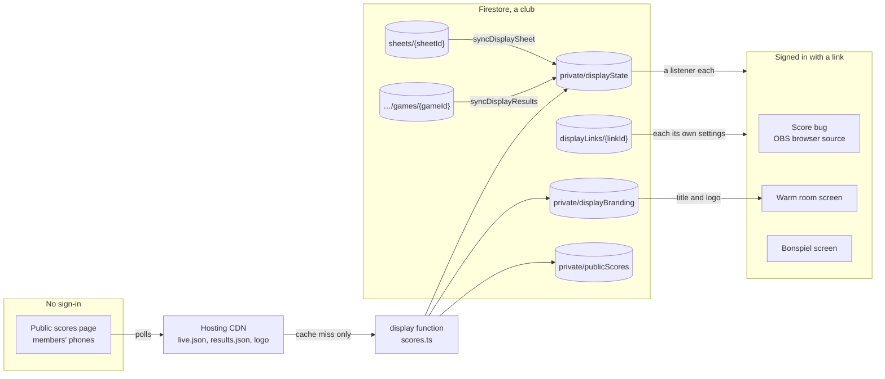
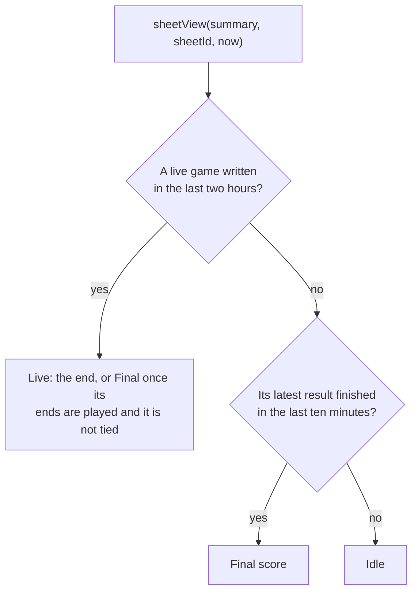
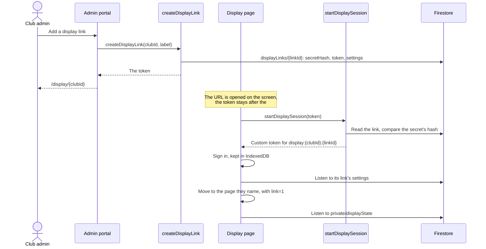
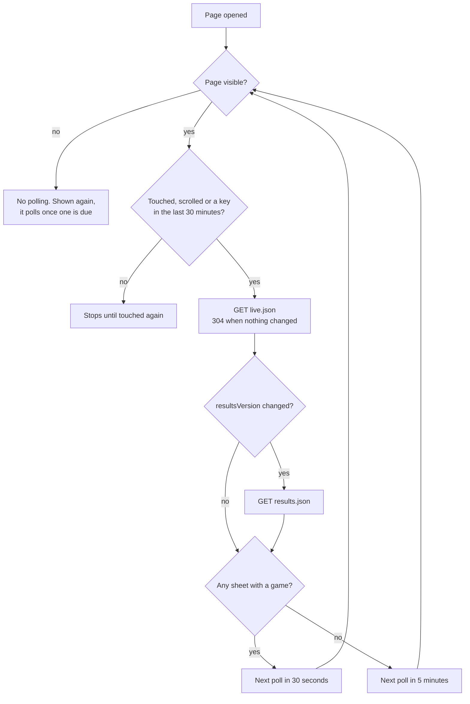

# Displays

The screens that show a club's scores without a scoreboard: the score bug
for live streams, the warm room screen, the bonspiel screen and the public
scores page for members' phones. Part of the
[architecture docs](../ARCHITECTURE.md).

## Two ways to watch



Club screens listen to Firestore: each costs a read when it starts and one a
change, however long it is open, and the club decides who has a link. The
public page is open to anyone, so it never touches Firestore itself and its
cost does not grow with the number of people watching.

## Display summary

The score bug for live streams and the warm room screen show a club's sheets
as they change. Reading the sheets themselves would cost a read per sheet
each time a display looked, so each club has one summary document,
`private/displayState`, that a display listens to instead: one read when it
starts and one per change after that, however long it stays open.

Two functions in `functions/src/display/triggers.ts` keep it up to date:

- `syncDisplaySheet` fires on every write to a sheet and copies its name and
  live game. A scoreboard's status report every half hour changes neither, so
  it ends there without a read or a write. Otherwise it rebuilds the entry
  from the sheet as it is now, in a transaction, rather than from the event:
  events can arrive late, out of order or twice, and this way a late one
  writes the current state again instead of an older one. A deleted sheet is
  removed.
- `syncDisplayResults` fires on each completed game and adds it to
  `results`, with its league's weekly draws read from the league as it is
  then. The list keeps the last day's games, latest first, up to 48, and a
  game delivered twice is listed once. A game a scoreboard that was offline
  delivers late goes in its place by when it finished.

The first writes only the sheet's entry and the second only `results` (and
the sheet's entry, for a sheet the summary has not seen yet), so neither
undoes the other. The entries carry only what a display shows: league and
team names, colors and scores, not the IDs integrations match on.

A sheet's final score is its latest game in `results`, found by
`lastGameOf`: by when it finished, so a game delivered late does not take
the place of a later one. Each sheet's entry used to keep its own copy as
`lastGame`; `syncDisplaySheet` replaces the whole entry, and the backfill
script rewrites every one, so that field goes.



What a display shows for a sheet is decided by `sheetView` in
`functions/src/display/state.ts`, from the summary and the sheet's ID. A
live game comes first, so the next draw replaces the final score as soon as
its game starts. A live game that has gone two hours without a write is
ignored, as in the REST API. Otherwise the sheet's latest result is shown as
the final score for ten minutes after it finished, and after that the sheet
is idle. That is worked out by the display from the
times in the summary, so nothing has to be written when the ten minutes are
up.

Sheets that existed before the functions were deployed, and the last day's
games, are added by `scripts/backfill-display-state.js` (see the README), or
by their next change.

A display page loaded before final scores came from `results` looks for
`lastGame`, so it shows no final score until it is reloaded. Pages from
before they reloaded themselves after a deploy (see
[Reloading display pages after a functions deploy](deploys-and-updates.md#reloading-display-pages-after-a-functions-deploy))
need reloading by hand once.

## Display links

A display, a warm room screen or an OBS browser source, has nobody to sign
in, so it signs in with a link instead. A club admin makes one per screen on
the portal's Displays tab, through
`createDisplayLink`. Its token is `<linkId>.<secret>`, the secret being 128
random bits in hex. The portal shows it built into the link's own URL,
whenever a club admin opens the link:

```
https://curlingscoreboard.app/display/{clubId}#k=<token>
```



That URL never has to change, because a link also says what its screens
show, in `settings`: the warm room with its view, or a sheet's score bug
with its size, caption and end side. A new link shows the warm room's totals.
Club admins change the settings, and the link's name, in the portal, which
writes them directly; the rules hold them to what the pages understand.
The page at the link's URL reads its own link (the rules let a display read
that one link and no other) and moves on to the page the settings name,
with `link=1` added after the `#`. A page opened that way keeps listening
to the link and moves again when the settings change, so a screen can be
pointed at another sheet or view from the portal, mid-stream if need be.
A page opened at its own URL, without `link=1`, stays where it is.

The token is kept on the link as `token`, so the URL can be copied again at
any time, the way club admins can see the API key. Only the club's admins,
super admins and the screen holding it can read it, and only the functions
write it. Signing in still checks a SHA-256 hash of the secret, which is
all that links made before the token was kept have; the portal shows those
without a URL until they are given a new one.

`resetDisplayLink` gives a link a new secret, and so a new URL, for one that
got out or was lost before it was copied. The settings stay, and screens on
the old URL stop within the hour, as for a removed link.

One link works for every page at its club. The token goes after the `#`,
which browsers never send to a server, so it stays out of request logs and
`Referer` headers. The page reads it and calls `startDisplaySession`, which
checks it in constant time and returns a custom token for the user
`display:{clubId}:{linkId}` with the display claims. Those let the page read
its club's display summary and nothing else. The club API key is never used:
it would expose the whole API, and replacing it would break the club's other
integrations.

`revokeDisplayLink` deletes the link and its Auth user. No new session can
start from it, and a screen already signed in stops within the hour, when
its ID token expires and cannot be renewed. The rules do not look the link
up on each read, which would cost a read every time a display listens.

`lastUsedAt` is written at most once an hour, so a screen that reloads often
does not write each time. A club can have 20 links.

Minting custom tokens needs the functions' service account to be able to
sign as itself; see "Display links" in the README.

## Display pages

The `display` function serves the display pages on the scoreboard's hosting
site, under `/display/**` through a Hosting rewrite, like the API:

- `/display/{clubId}/sheets/{sheetId}/bug`: the score bug
- `/display/{clubId}/warm-room`: every sheet, for a screen in the club
- `/display/{clubId}/bonspiels/{bonspielId}`: a bonspiel's draws and brackets,
  for a screen in the club
- `/display/{clubId}`: a display link's own URL, which opens the page its
  settings name
- `/display/{clubId}/scores`, with `live.json`, `results.json` and `logo`
  under it: the [public scores page](#public-scores-page), which needs no
  sign-in
- `/display/assets/*`: the pages' scripts and styles, from
  `functions/src/display/assets`, which `npm run build` copies next to the
  compiled function

A page is the same for everyone and never reads Firestore on the server: the
link's token is after the `#`, which the function never sees. The HTML only
holds a JSON block saying which club and sheet to show, the Firebase web
config, and the server's time. The script, `assets/display.js`, then:

1. Signs in. A display already signed in as this link, from an earlier
   load, carries on; otherwise it calls `startDisplaySession` with the token
   and signs in with the custom token it returns. The sign-in is kept in the
   browser's IndexedDB, so a reload does not start a new session.
2. Listens to the club's `private/displayState` and redraws on each change.
3. Redraws every 15 seconds as well, because a final score comes down ten
   minutes after the game with no write to say so. `sheetView` and
   `lastGameOf` there mirror the ones in `functions/src/display/state.ts`,
   with the same limits passed
   in through the page. Times are compared on the server's clock, worked out
   from the time in the page, so a screen with its clock off still takes
   the final score down on time.

A display is left running for weeks, so everything is retried, backing off
to five minutes: a failed sign-in, a listener the server ended, a sign-in
that could not be renewed. A link the server refuses, or a URL with no
token, is said on the page so it can be fixed while setting up; the page is
otherwise silent about trouble and keeps showing the last scores.

The Firebase SDK is loaded as ES modules from `www.gstatic.com`, pinned to
the version the admin portal uses. Nothing is inline, so the
`Content-Security-Policy` allows scripts only from the function and gstatic,
connections only to the Firebase services the page uses, and no framing.
Responses carry `X-Content-Type-Options: nosniff` and
`Referrer-Policy: no-referrer`; pages are `no-store`, since they carry the
server's time, and assets `no-cache`.

### Score bug

The score bug is transparent, so an OBS browser source shows only the bug.
It shows the two teams with their rock colors and scores, the hammer in a
live game, and the end (or Final) in a box beside the scores, as large as
they are, and hides itself while the sheet is idle. A name too long for its
row shrinks to 80% before it is cut short. `?scale=` (0.5 to 4) sizes it,
and `?label=league` or `?label=none` changes or removes the sheet name in
the caption under it, and `?end=left` moves the end box to the left of the
names. `?preview` is for setting it up: while the sheet has
no game it shows a faded, outlined stand-in at the bug's real size instead of nothing, so it can be placed in OBS between draws. A link's
own URL carries `?preview` on to the page it opens, and the portal's
Preview button opens a link that way.

### Warm room screen

The warm room screen shows every sheet in the summary, in name order with
numbers in order ("Sheet 2" before "Sheet 10"), on a dark background meant
for a TV. Each card has the sheet's name, the end or Final, the league, and
both teams with their rock colors, scores and the hammer; an idle sheet is
dimmed and says "No game". The page tries each number of columns and keeps
the one that makes the cards largest, then sizes everything in a card from
its width, so any number of sheets fills the screen without scrolling, on a
1080p or 4K TV or one turned on its side. A clock in the corner, on the
server's time, shows the screen is still running. The mouse pointer hides
once it has been still for three seconds and comes back when it moves, so
a mouse left by a TV does not sit over the scores.

A club can give the screen its own title in place of "Live Scores", and a
logo beside it, on the portal's Displays tab. Both are kept in `private/displayBranding`, which the page listens to
alongside the summary: one more read when it starts, and one when the club
changes them. The portal shrinks the logo in the browser to fit 800 by 200
pixels and keeps it as a PNG, or WebP when a PNG would be too large, in a
data URL. Keeping it in Firestore rather than Cloud Storage means the page
needs nothing but Firestore, and the CSP already allows `data:` images. Any
image the browser can show, SVG included, is redrawn as a plain image, and
the rules accept only PNG, JPEG and WebP data URLs, so nothing that can
carry a script is stored.

`?view=full` shows each game end by end instead, like the scoreboard's own
baseball layout: a column per end, the scoring team's points on its rock
color and 0 for the other team, the end being played picked out, and the
totals. It has as many columns as the game's `numberOfEnds`, or more once
extra ends are played. Its cards are wider and shorter, so the layout asks
for that shape. A live game from a scoreboard that does not send its ends
yet is shown by its totals among them. `?view=cycle` shows the two in turn,
`?every=` seconds each (20 by default).

`?earlier=today` adds the day's finished games in a column to the right of
the sheets (under them on a TV turned on its side), for a screen left on
through several draws, such as one in the bar. It is a link setting, off
unless a club admin turns it on, and a screen already following its link
picks it up as soon as it is saved. The games are grouped by draw, the
latest draw first, each headed by its start time and its leagues, and in
sheet order under it: the sheet, then each team's rock color, name and
score, the winner in bold, and "Final after 7 ends" for a game that ended
early or went to extra ends. The column is hidden until the first game of
the day finishes, and the sheets get its width back. With `?preview`, as the
portal's Preview button opens it, the column shows before then too, faded and
outlined like the score bug's stand-in, with a note that the day's results
appear there as games finish, so whoever sets the screen up sees the room it
takes.

The grouping is worked out on the screen, in `results-model.js`, because it
is at the club and so on the club's time, which is what leagues' draws are
written in; the club has no time zone of its own. A league game goes under
the league draw on that weekday that it started in, from half an hour
before the draw starts, as on the scoreboard, until it ends. An open game,
a bonspiel game, or a league game outside its league's draws joins a draw
that started from half an hour before to 45 minutes after it did, and
games with no draw to join are grouped with those that started within 45
minutes of the first of them, under that start to the nearest quarter
hour. The day starts at 4 in the morning, so a late draw that runs past
midnight stays with its evening.

The column never scrolls or turns over by itself. What does not fit is left
off the bottom a whole game at a time, so the oldest games go first, and a
draw with no games left goes too. It is sized from the screen's height, a
720th of it to a design pixel (or a 1280th of its width if that is less),
so it keeps its proportions on any 16:9 screen; on a TV turned on its side,
the other way round.

Both pages say Final, not the end, once a live game has played its ends
and is not tied, as the scoreboard does before anyone taps Finish Game, and
"Extra end" once a tied game goes past them. Where they show a game's
league, a bonspiel game shows its bonspiel's name.

### Bonspiel screen

The bonspiel screen, `bonspiel.js`, listens to the bonspiel's plan and state
as well as the summary, which the rules let a display read. Its live scores
come from the summary: a sheet's live or just finished game whose
`bonspiel.id` is this bonspiel's is shown as the game its `gameId` names.
What it works out from the plan and state, the draw on now and each event's
bracket, is in `bonspiel-model.js`, which has neither Firebase nor the page
in it, so the emulator tests run it. Its views, in the warm room's colors and
sized to the screen:

- `?view=now`, the default: the draw on now as large cards, one a sheet, with
  each game's teams, live score and end, or Final; and the next draw's games
  as a list, with any team not known yet as where it comes from ("Winner of
  A3"). A draw is on from 30 minutes before it starts, as on the scoreboard.
  On a screen turned on its side the cards go two across.
- `?view=schedule`: a row a draw and a column a sheet, the draw on now marked.
  When there are more draws than fit, they start from the one before it.
- `?view=brackets`: each event as the portal's bracket view lays it out, one
  at a time, sized so its biggest round fits; the subtitle names the winner
  once there is one. A pool shows its standings instead.
- `?view=cycle`: all of them in turn.

With more than one screen, each shows for `?every=` seconds (20 by default).

### Serving the pages

The rewrite needs the `display` function to exist, so in a new project deploy
the functions before the scoreboard's hosting.

## Public scores page

`/display/{clubId}/scores` is the club's scores for members' phones: every
sheet with its game, the event (the bonspiel's name, otherwise the league's),
end and hammer, a tap to see a game end by end, and the day's results grouped
by draw as the warm room groups them. A club admin turns it on in the portal,
which sets `private/publicScores`. It has no sign-in: anyone with the address
can see it, team names included.

So that its cost does not grow with the number of people watching, the page
loads no Firebase. It polls JSON from the `display` function, which Hosting's
CDN caches, so only a cache miss reaches the function and Firestore
(`functions/src/display/scores.ts` builds the JSON from the display summary):

| Path, under `/display/{clubId}/scores/` | What | Cache-Control |
|---|---|---|
| `live.json` | each sheet and what it shows now, about a kilobyte, and versions of the other two | `public, max-age=15, s-maxage=30` |
| `results.json` | the day's finished games | `public, max-age=60, s-maxage=300` |
| `logo?v=` | the club's logo as an image | a year, `immutable`, at its own version |

A club without the page turned on gets a 404 for each, cached for a minute.
Express gives each response an ETag and answers a matching `If-None-Match`
with a 304, so a poll that finds nothing new costs only headers. A cache miss
reads the switch and the summary; the branding, which holds the logo, is
kept in each function instance for five minutes.



The page (`assets/scores.js`, its timing in `assets/scores-model.js`) polls
`live.json` every 30 seconds while any sheet has a game, every 5 minutes while
none does, not at all while it is hidden, and stops after 30 minutes without a
tap, scroll or key until it is touched again. It fetches `results.json` only
when `live.json`'s `resultsVersion` changes. A score can take up to about a
minute to reach a phone.

## Display status

The display pages report on themselves the same way as scoreboards (see
[Scoreboard status](scoreboard.md#scoreboard-status)), to their display
link's `device` field (`buildStatus` in `display.js`): once signed in, when
the page is shown again, when it learns a new build has been deployed, and
every 30 minutes. The Displays tab shows each link's version, whether it is
open, and "Update pending" while its `buildId` differs from
`appConfig/displays`. Screens are often switched off between events, so a
link that has gone quiet is shown as not open rather than as a problem.
