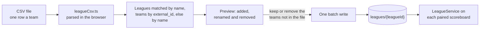
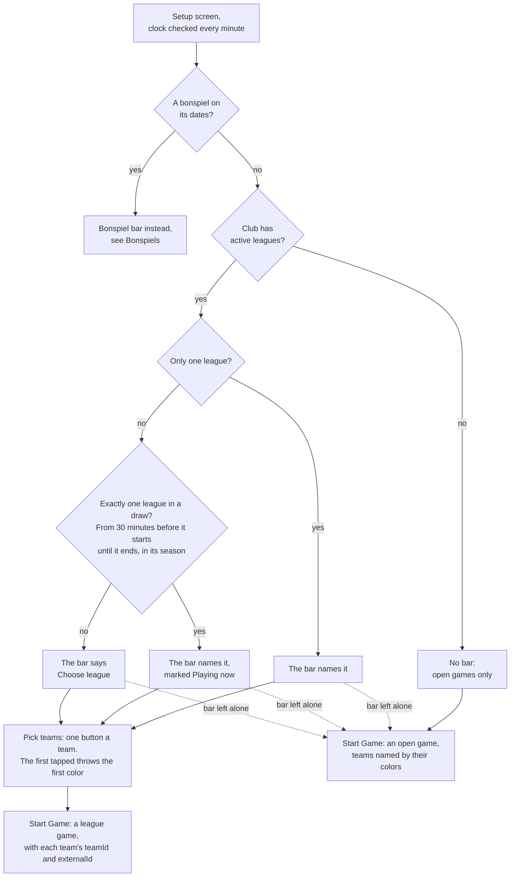

# Leagues and teams

How leagues are stored and imported, and how a scoreboard offers league teams.
Part of the [architecture docs](../ARCHITECTURE.md).

## Leagues

A league is one document holding its weekly schedule and its teams. Teams are
embedded, not a subcollection, so a scoreboard gets everything it needs to
offer teams in one read per league, and an import replaces a league's teams
in a single write.

Club admins manage leagues in the admin portal: by hand on a league's page,
or by importing a CSV file with one row per team.

```
league,day,start,end,team,external_id
Monday Night,Mon,18:30,20:30,Team Smith,1042
```



Only `league` and `team` are required. The file is parsed in the browser
(`admin/src/lib/leagueCsv.ts`) and the portal shows what would be added,
renamed and removed before writing anything, all in one batch. Leagues match
by name. Teams match by `external_id` when both sides have one, otherwise by
name, and keep their `id`, so a re-import or a rename does not orphan games
recorded against a team. Teams the file does not mention are kept or removed,
whichever the admin chooses. Times and days are plain values with no time
zone: scoreboards compare them with their own clock.

Dates and times are stored as strings for the same reason. A Firestore
timestamp is an instant, and "Mondays at 18:30" is not one.

## League games on the scoreboard



`LeagueService` on a paired scoreboard listens to its club's active leagues
and, like the rock colors, keeps the last ones it saw for an offline start.
The game setup screen fills the display, and each of its settings is a row
of equal-width segments spanning the same width, so the controls line up down
both edges and grow with the screen.

While there are any leagues, the setup screen gains one bar above its settings.
Leaving the bar alone starts an open game exactly as before.

The left of the bar is the league. It follows the scoreboard's local clock:
if exactly one league is in a draw (from half an hour before it starts until
it ends, within the league's season) the bar names it and marks it as playing
now, and a club's only league is always named. Tapping it opens a modal of
the club's leagues, the ones playing now first, to choose another; that
clears any teams already picked. The modal puts leagues two across once there
are more than three and shares its height between the rows, so a club's ten
or so leagues are all on screen without scrolling. The bar re-reads the clock every minute, because the setup
screen is left open between games, sometimes overnight.

The right of the bar opens a full screen team picker for that league. With no
league to go on, it asks for the league first and carries straight on.

The picker is only teams: no title and no league control, so the buttons get
the room. Every team in the league is one large button on a fixed four by
four grid, which holds the thirteen teams of the largest league expected. A
smaller league leaves cells empty instead of growing its buttons, so the
screen looks the same from one league to the next; only a league of more than
sixteen changes the grid. All buttons share one text size, capped so that
most leagues match, and smaller only when a team name is unusually long. The first team tapped throws the first rock color and the
second the other. Two slots at the top show who is picked; tapping a slot or
a picked team clears it, a third tap replaces the second team, and a swap
button exchanges the colors. Cancel and Done are bottom right. Back on the
setup screen the bar shows the matchup and the hammer choice names the two
teams.

Done sits in the same corner as Start Game, so the setup screen ignores taps
for a moment after the picker closes. Otherwise a double tap on Done would
start the game.

## Changing the teams during a game

Teams forget to pick their names, or pick the wrong ones. While a club has
leagues, a Teams button on the scoreboard and a tap on the team names under
the scores both open the same team picker, at any point until the game
finishes.
A league game picks from its own league, starting from the teams it has; an
open game asks for the league first and becomes a league game. The rock
colors stay as they are, so the swap button is how a matchup put on the wrong
colors is fixed.

Once a team has a name of its own, the scoreboard shows both names on their
rock colors under the total scores, so the players can check them. An open
game has none, as its names would only spell out the colors.

The game carries the league and each team's `teamId` and `externalId`, which
are written with `liveGame` and the completed game. The name and IDs are
copied when the teams are picked, so the record stands by itself whatever
happens to the league afterwards, and it is what a later score reporter needs
to match a result to a team.
