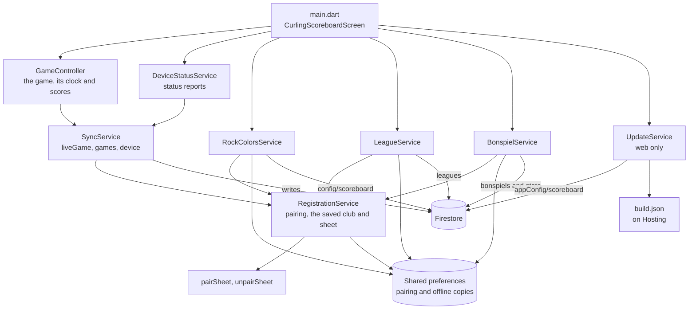
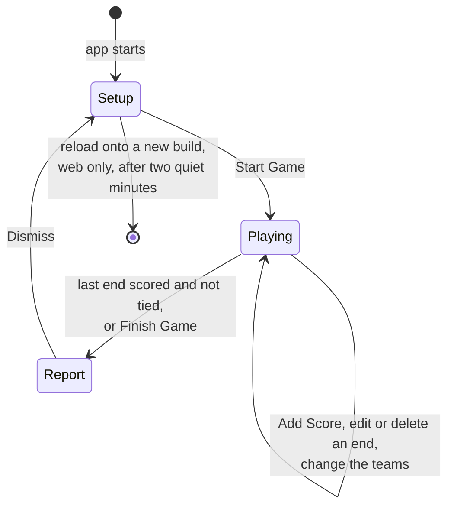
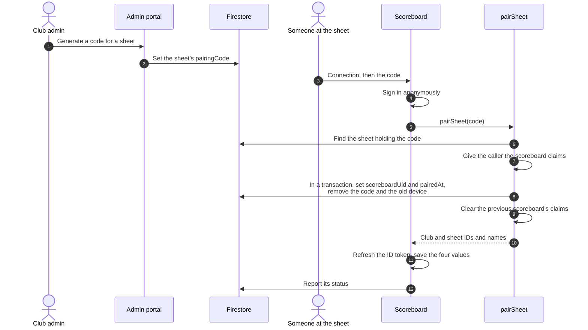
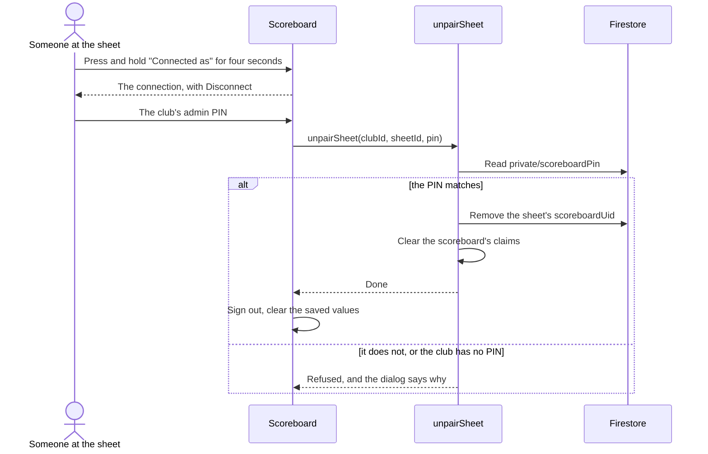

# Scoreboard app

The Flutter app that runs on each sheet: how it is put together, how a game
is played on it, and how it pairs with a club and syncs. Part of the
[architecture docs](../ARCHITECTURE.md). The code is in [`app/`](../../app/),
whose README maps its folders.

## How the app is put together

`GameController` holds the game and the rules for playing it, and knows
nothing about Firebase beyond calling `SyncService`, which does nothing
unless the scoreboard is paired. The club services each listen to one part
of the paired club, keep the last they saw in shared preferences for an
offline start, and fall back to the app's defaults when unpaired. The game
itself is never saved on the device.

## Playing a game

- **Setup.** The game setup screen fills the display and cannot be dismissed
  without starting a game. It sets the number of ends (8 by default),
  players per team, which paces the game clock at 15 minutes an end for
  fours and 12 for doubles (or hides the clock), and who has hammer in the
  first end. For a paired club it adds the league bar or, on a bonspiel's
  dates, the bonspiel bar; see [Leagues](leagues.md#league-games-on-the-scoreboard)
  and [Bonspiels](bonspiels.md#on-the-scoreboard). The connection to the club
  is in its bottom corner.
- **Playing.** Add Score enters the next end: which team scored and how many,
  or a blank end. Tapping an end already played corrects it, or deletes one
  entered by mistake, such as an end both teams entered. Hammer is worked out again from every end
  each time, so a corrected end gives the same answer as if it had been
  entered that way. The game clock shows the time played and how far ahead or
  behind the pace it is. A tied game goes to an extra end.
- **Layouts.** Settings switches between the Baseball layout, a column for
  each end with each team's points in it, and the Curling Club layout, the
  board on club walls: points 1 to 12 across the middle, with the number of
  each end hung in a team's row at the total that team had reached by it. It
  only changes how the game is shown.
- **Finishing.** The game finishes by itself when the last end is scored and
  it is not tied, or with Finish Game, which asks first. The Game Report shows
  the final score and each end with how long it took, and dismissing it goes
  back to setup.

## Pairing a scoreboard

1. A club admin generates a six character code for a sheet in the admin
   portal. It is stored as `pairingCode` on the sheet.
2. On the scoreboard's game setup screen, Connection opens the dialog the
   code is entered in.
3. The app signs in anonymously and calls the `pairSheet` callable function.
4. `pairSheet` finds the sheet holding the code with a collection group query
   and sets the caller's scoreboard claims. Then in a transaction it sets
   `scoreboardUid` to the caller's uid, records `pairedAt`, and removes the
   code along with any `device` status left by the previous scoreboard. It
   clears the previous scoreboard's claims and returns the club and sheet IDs
   and names.
5. The app refreshes its ID token so the claims take effect, and saves those
   four values in shared preferences. From then on it is paired.

`pairSheet` refuses callers who already have an admin role, because setting
the scoreboard claims would replace it.

Clients cannot query or read pairing codes or club documents themselves. The
rules used to allow that, which let any signed in client list every unpaired
sheet's code and read every club's API key; moving the lookup into
`pairSheet` closed it.

## Disconnecting a scoreboard

Disconnecting is kept out of the way, because scoreboards sit where anyone can
tap at them. A connected scoreboard's setup screen only says "Connected as
club – sheet". Pressing and holding that for four seconds, with a ring filling
in meanwhile, opens a dialog showing the connection with a Disconnect button,
and that asks for the club's admin PIN. Settings has nothing about the
connection.

Each club has one PIN. A super admin sets it when creating the club, and the
club's admins can change it in the admin portal. It is kept in `clubs/{clubId}/private/scoreboardPin`, which scoreboards cannot read.
The app sends what was typed to the `unpairSheet` callable function, which
checks it, removes `scoreboardUid` from the sheet and clears the scoreboard's
claims. The rules do not let a scoreboard remove its own `scoreboardUid`, so
the PIN cannot be skipped. A club with no PIN set, which only clubs created
before PINs can be, cannot disconnect its scoreboards until an admin sets one
or `scripts/backfill-scoreboard-pins.js` gives it one.

`unpairSheet` asks for no PIN when the sheet is not the caller's, which is
the case for a scoreboard whose pairing was lost: there is nothing left to
protect, and it lets that scoreboard be cleared and paired again. Nothing
changes on the sheet.

Once the function succeeds the app signs out and clears the saved values.
Scoring carries on locally either way.

A sheet can be taken away from a scoreboard without it being told: pairing
another device replaces `scoreboardUid`, and the first one still has its saved
values. It finds out when the rules refuse one of its writes, usually the
status report it sends on startup. `SyncService` then sets
`RegistrationService.pairingLost`, and the setup screen says scores are not
syncing, and the connection dialog prompts to disconnect and pair again. A later write that succeeds clears
it.

## Syncing scores

`SyncService` in the app does nothing unless the scoreboard is paired.
Writes are fire and forget, so a failed write never interrupts scoring, and
Firestore's offline cache sends them once the connection is back.

`GameController`, which holds the game on the scoreboard, makes the calls at
these points:

| Event in the app         | Firestore write                                           |
| ------------------------ | --------------------------------------------------------- |
| The app starts           | Remove `liveGame`                                         |
| A game is started        | Overwrite `liveGame` on the sheet                         |
| A score is entered or edited | Overwrite `liveGame` on the sheet                     |
| The teams are changed    | Overwrite `liveGame` on the sheet                         |
| Finish Game              | Add a `games` document and remove `liveGame`, in one batch |

A game is live from the moment it starts, so the first end shows at 0-0.

A game that is never finished would otherwise stay live forever. The app
does not persist game state, so it removes `liveGame` on startup. For a
scoreboard that is switched off or offline, readers ignore a `liveGame`
whose `updatedAt` is more than 120 minutes old: the REST API reports it as
null and the admin portal shows the sheet as idle. The stored field is left
alone until that scoreboard next starts up or starts a game.

## Rock colors

The scoreboard is red and yellow out of the box: those two colors are built
into the app (`RockColors.defaults`), so an unpaired or offline scoreboard
needs nothing from Firebase to show them.

A club that plays with other colors picks them in the admin portal from a
fixed list, which writes `rockColors` to `clubs/{clubId}/config/scoreboard`.
`RockColorsService` on a paired scoreboard listens to that document and keeps
the last colors it saw in shared preferences, so they are still right when it
starts up offline. Disconnecting clears them. Choosing red and yellow removes
the setting, leaving the app's defaults as the only definition of them.

Colors are read when a game starts and copied onto its teams, so a change
never lands in the middle of a game. They are written with `liveGame` and the
completed game as each team's `color`, and the team `name` is the color's
name ("Blue", "Green"), which is what the REST API returns.

## Scoreboard status

So the admin portal can show what each sheet is running, a paired scoreboard
reports on itself. `DeviceStatusService` builds the report and `SyncService`
overwrites the sheet's `device` field with it:

- when the app starts
- right after pairing
- when the app returns to the foreground
- when it learns a new build has been deployed
- every 30 minutes in between (`Constants.deviceStatusHeartbeat`)

`lastSeenAt` is the server's time, so the portal can trust it; everything else
is whatever the app says, and is only ever displayed. The portal calls a
scoreboard offline once it has missed two heartbeats (65 minutes), and shows
"Update pending" while its `buildId` differs from `appConfig/scoreboard`.
`lastSyncError` is the most recent failed write since the app started, which
is otherwise invisible because writes are fire and forget.

The public REST API builds its sheet responses field by field, so none of
this is exposed there.

How the web app reloads itself onto a new build is in
[Deploys and updates](deploys-and-updates.md#reloading-scoreboards-after-a-web-deploy).
